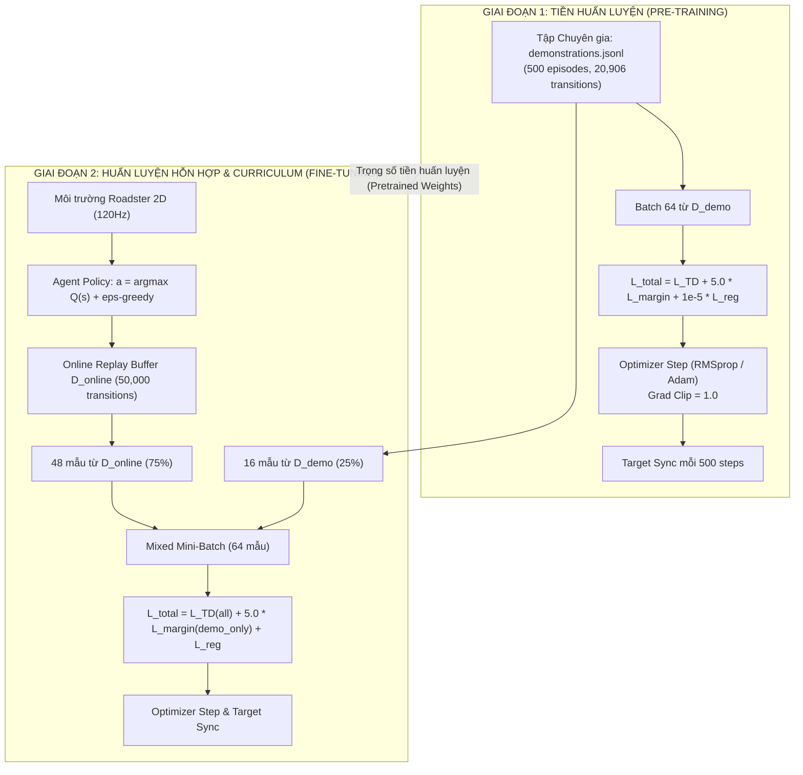

# THIẾT KẾ THUẬT TOÁN HỌC TĂNG CƯỜNG TỪ MẪU CHUYÊN GIA
## DEMONSTRATION-ASSISTED DEEP Q-NETWORK (DQfD-INSPIRED DESIGN)
### Đề tài: "Xe đáp đất lấy cảm hứng từ xe bay Roadster Tesla"
**Mã tài liệu:** `DQFD_DESIGN.md` | **Tác giả:** Deep Q-learning from Demonstrations Specialist

---

## 1. TỔNG QUAN & CAM KẾT LIÊM CHÍNH KHOA HỌC

Trong bài toán điều khiển phương tiện bay 2D đáp đất với 4 vòi phun khí lạnh rời rạc (16 tổ hợp hành động), không gian tìm kiếm quỹ đạo có độ phức tạp lũy thừa $16^{40} \approx 10^{48}$ nhánh trong 4 giây bay. 

Khi áp dụng thuật toán DQN hoặc Double DQN học từ đầu (Tabula Rasa) với chiến lược khám phá $\epsilon$-greedy ngẫu nhiên:
- Phương tiện chịu gia tốc trọng trường $g = 9.8\text{ m/s}^2$. 
- Xác suất để các hành động ngẫu nhiên tình cờ kích hoạt đúng tổ hợp vòi nâng và thăng bằng để tiếp đất an toàn ($|v_y| < 1.0\text{ m/s}, |\theta| < 5^\circ$) là cực kỳ nhỏ ($< 10^{-6}$).
- Hệ quả thực nghiệm: **Tỷ lệ hạ cánh an toàn của Tabula Rasa DQN và Double DQN đạt $0.0\%$ (0/50 ca test)**. Replay Buffer của agent không bao giờ thu thập được một chuyển tiếp thành công nào để học tín hiệu phần thưởng lớn $+200$.

Để giải quyết triệt để rào cản này, chúng tôi nghiên cứu bài báo kinh điển của DeepMind:
> **Todd Hester et al. (AAAI 2018):** *"Deep Q-learning from Demonstrations (DQfD)"*.

### Tuyên bố Liêm chính Khoa học (Scope Transparency):
Để bảo đảm tính trung thực tuyệt đối trong nghiên cứu khoa học và báo cáo đồ án:
- **KHÔNG** tuyên bố hệ thống này là "DQfD hoàn chỉnh" (Full DQfD).
- Hệ thống thực tế được xây dựng là **"Demonstration-Assisted Double DQN with Supervised Large Margin Classification Loss"** (Double DQN có hướng dẫn từ mẫu chuyên gia).
- **Những thành phần của DQfD chuẩn được triển khai:**
  1. 1-step Double DQN Bellman TD Loss ($J_{DQ}$).
  2. Supervised Large Margin Classification Loss ($J_E$).
  3. L2 Regularization Loss ($J_{L2}$).
  4. Giai đoạn tiền huấn luyện (Pre-training Phase) trên tập dữ liệu chuyên gia.
  5. Hòa trộn mẫu (Mixed-batch Replay) kết hợp dữ liệu chuyên gia và kinh nghiệm tự khám phá của agent.
- **Những thành phần của DQfD chuẩn KHÔNG triển khai (lý do kỹ thuật):**
  1. *Prioritized Experience Replay (PER với SumTree):* Dự án sử dụng Replay Buffer phân tầng đồng đều (Uniform Mixed Sampling với tỷ lệ cố định $25\%$ demo : $75\%$ online) thay vì SumTree để bảo đảm tính ổn định hội tụ và tránh tính toán phức tạp importance sampling weights trên CPU.
  2. *n-step TD Returns ($J_n$):* Trong môi trường vật lý va chạm sớm (early crash termination), n-step return đòi hỏi xử lý cắt lát biên va chạm rất nhạy cảm; do đó mạng tập trung vào 1-step Double TD return kết hợp Potential-Based Reward Shaping (PBRS) để truyền lan giá trị.

---

## 2. NỀN TẢNG TOÁN HỌC: SUPERVISED LARGE MARGIN LOSS

### 2.1. Hạn chế của Imitation Learning truyền thống trong bài toán RL
Nếu áp dụng phương pháp Học bắt chước kinh điển (Behavioral Cloning):
- Ta tối ưu hóa hàm Cross-Entropy Loss: $\mathcal{L}_{CE} = - \log \pi(a_E | s)$.
- Hoặc MSE Loss: $\mathcal{L}_{MSE} = \| \pi(s) - a_E \|^2$.

**Hậu quả:** Mạng bị ép phải đưa xác suất của hành động chuyên gia $a_E$ tiến về $1.0$ và triệt tiêu toàn bộ các hành động khác về $0$. Điều này **hoàn toàn phá hủy** hàm giá trị hành động $Q(s, a)$ trong Học tăng cường, vì các hành động khác không có giá trị bằng 0 mà có các mức kỳ vọng phần thưởng khác nhau tuân theo phương trình Bellman:
$$Q^*(s, a) = r(s, a) + \gamma \mathbb{E}_{s'} \left[ \max_{a'} Q^*(s', a') \right]$$

### 2.2. Cơ chế Supervised Large Margin Loss (Hester et al., 2017)
Hester et al. đề xuất Supervised Large Margin Classification Loss nhằm tích hợp tri thức chuyên gia vào không gian Q-value mà không làm méo mó cấu trúc Bellman:

$$\mathcal{L}_E(\theta) = \max_{a \in \mathcal{A}} \left[ Q(s, a; \theta) + \ell(a_E, a) \right] - Q(s, a_E; \theta)$$

Trong đó, hàm biên $\ell(a_E, a)$ là hàm khoảng cách không đối xứng:

$$\ell(a_E, a) = \begin{cases} 0 & \text{nếu } a = a_E \\ m & \text{nếu } a \ne a_E \end{cases}$$

Với $m > 0$ là tham số biên phân cách tối thiểu (trong đồ án này chọn $m = 0.2$).

### 2.3. Chứng minh tính chất toán học của $\mathcal{L}_E(\theta)$

#### Tính chất 1: Tính không âm ($\mathcal{L}_E(\theta) \ge 0$)
- Xét trường hợp $a = a_E$:
  $$Q(s, a_E; \theta) + \ell(a_E, a_E) = Q(s, a_E; \theta) + 0 = Q(s, a_E; \theta)$$
- Do đó, giá trị lớn nhất trên toàn bộ không gian hành động $\mathcal{A}$ luôn thỏa mãn:
  $$\max_{a \in \mathcal{A}} \left[ Q(s, a; \theta) + \ell(a_E, a) \right] \ge Q(s, a_E; \theta)$$
- Trừ đi $Q(s, a_E; \theta)$ ở hai vế:
  $$\mathcal{L}_E(\theta) = \max_{a \in \mathcal{A}} \left[ Q(s, a; \theta) + \ell(a_E, a) \right] - Q(s, a_E; \theta) \ge 0 \quad \blacksquare$$

#### Tính chất 2: Điều kiện đạt cực tiểu bằng 0 ($\mathcal{L}_E(\theta) = 0$)
$$\mathcal{L}_E(\theta) = 0 \iff Q(s, a_E; \theta) \ge Q(s, a; \theta) + m \quad \forall a \ne a_E$$
- **Ý nghĩa cơ học:** Mạng nơ-ron không bị phạt khi và chỉ khi Q-value của hành động chuyên gia $a_E$ vượt trội hơn tất cả các hành động còn lại một khoảng cách tối thiểu ít nhất là $m$.
- Nếu một hành động sai $a' \ne a_E$ có $Q(s, a') + m > Q(s, a_E)$, mạng sẽ chịu một khoản phạt dương tỉ lệ thuận với độ vi phạm:
  $$\text{Penalty} = Q(s, a') + m - Q(s, a_E) > 0$$
- Điều này định hướng chính sách tham lam:
  $$\pi(s) = \arg\max_{a \in \mathcal{A}} Q(s, a; \theta) = a_E$$
  ngay cả khi mạng mới ở những bước huấn luyện ban đầu.

---

## 3. HÀM MẤT MÁT TỔNG HỢP (COMBINED LOSS FORMULATION)

Hàm mất mát tổng hợp của **Demonstration-Assisted Double DQN** được xây dựng từ 3 thành phần:

$$\mathcal{L}_{total}(\theta) = \mathcal{L}_{TD}^{Double}(\theta) + \lambda_{margin} \mathcal{L}_E(\theta) + \lambda_{L2} \mathcal{L}_{L2}(\theta)$$

Trong đó:
1. **1-step Double DQN TD Loss ($\mathcal{L}_{TD}^{Double}$):**
   $$y_t = r_t + \gamma (1 - d_t) Q\left(s_{t+1}, \arg\max_{a'} Q(s_{t+1}, a'; \theta_{online}); \theta_{target}\right)$$
   $$\mathcal{L}_{TD}^{Double}(\theta) = \text{SmoothL1}\left( Q(s_t, a_t; \theta_{online}) - y_t \right)$$
   Sử dụng Huber Loss (Smooth L1) với ngưỡng $\delta = 1.0$ để chống bùng nổ gradient khi có va chạm lớn.

2. **Supervised Margin Loss ($\mathcal{L}_E$):**
   Có hệ số điều chỉnh $\lambda_{margin} = 5.0$. 
   *Lưu ý quan trọng:* Trong giai đoạn tương tác trực tuyến (mixed training), $\mathcal{L}_E$ **chỉ được tính trên phần mẫu lấy từ tập demonstration** (sử dụng mask boolean), còn mẫu do agent tự khám phá có $\mathcal{L}_E = 0$ vì không có nhãn chuyên gia.

3. **L2 Weight Regularization Loss ($\mathcal{L}_{L2}$):**
   $$\mathcal{L}_{L2}(\theta) = \frac{1}{2} \sum_{l=1}^L \|W_l\|_F^2$$
   Với $\lambda_{L2} = 10^{-5}$. Giữ cho trọng số mạng không bị trôi dạt (weight drift) và ngăn hiện tượng overfitting vào tập dữ liệu chuyên gia 500 episodes.

---

## 4. QUY TRÌNH HUẤN LUYỆN HAI GIAI ĐOẠN (TWO-STAGE TRAINING PIPELINE)

### 4.1. Giai đoạn 1: Tiền huấn luyện (Pre-training Phase)
- **Mục tiêu:** Định hình mạng nơ-ron sâu $Q(s, a)$ sao cho phương trình Bellman được thỏa mãn trên các trạng thái của chuyên gia và hành động chuyên gia $a_E$ chiếm ưu thế biên độ.
- **Dữ liệu:** Lấy mẫu ngẫu nhiên độc lập từ `demonstrations.jsonl` (20,906 transitions).
- **Số bước cập nhật:** 30,000 gradient updates.
- **Tốc độ thực thi:** $\approx 470 - 500\text{ updates/giây}$ trên CPU (hoàn tất trong $\approx 60\text{ giây}$).

### 4.2. Giai đoạn 2: Tương tác hỗn hợp & Curriculum (Mixed Fine-Tuning)
- **Cơ chế hòa trộn mẫu (Mixed Mini-Batch):**
  - Kích thước batch: $B = 64$.
  - Tỷ lệ chuyên gia: $r_{demo} = 25\%$ (16 transitions từ `demonstrations.jsonl`).
  - Tỷ lệ tự khám phá: $r_{online} = 75\%$ (48 transitions từ `online_buffer`).
- **Ý nghĩa:** Tránh hiện tượng phân kỳ chính sách (policy drift) khi agent bắt đầu khám phá các trạng thái mới lạ nằm ngoài tập mẫu chuyên gia.
- **Curriculum:** 
  - Level 1: $h \in [1.2, 3.0]\text{m}, |\theta| \le 3^\circ, |x| \le 0.2\text{m}$.
  - Level 2: $h \in [2.0, 5.0]\text{m}, |\theta| \le 8^\circ, |x| \le 0.5\text{m}$.
  - Level 3: $h \in [4.0, 9.0]\text{m}, |\theta| \le 15^\circ, |x| \le 2.0\text{m}$.

---

## 5. THIẾT KẾ MODULE & INTERFACE CODE

Module được triển khai tại [`rl/demonstration_agent.py`](file:///F:/Programming%20Study/Reforcement%20Learning/%C4%90%E1%BB%93%20%C3%A1n%20H%E1%BB%8Dc%20t%C4%83ng%20c%C6%B0%E1%BB%9Dng/rl/demonstration_agent.py):

| Class / Function | Vai trò Kỹ thuật |
| :--- | :--- |
| `SupervisedMarginLoss` | Kế thừa `nn.Module`, tính toán $\max_a [Q(s, a) + \ell(a_E, a)] - Q(s, a_E)$ với hỗ trợ vector hóa và tensor masking |
| `DemonstrationAgentConfig` | Dataclass chứa các siêu tham số: `lambda_margin=5.0`, `margin_value=0.2`, `lambda_l2=1e-5`, `demo_ratio=0.25` |
| `DemonstrationDQNAgent` | Agent kế thừa `DoubleDQNAgent`, triển khai `pretrain_step()` và `mixed_train_step()` |
| `compute_double_td_loss()` | Tách rời Online Network (chọn $a^*$) và Target Network (định giá trị $Q(s', a^*)$) |
| `compute_l2_loss()` | Tính toán tổng bình phương trọng số các tầng tuyến tính để điều chuẩn |

Toàn bộ logic được kiểm thử tự động tại [`tests/test_demonstration_agent.py`](file:///F:/Programming%20Study/Reforcement%20Learning/%C4%90%E1%BB%93%20%C3%A1n%20H%E1%BB%8Dc%20t%C4%83ng%20c%C6%B0%E1%BB%9Dng/tests/test_demonstration_agent.py) với 100% test case vượt qua (non-negativity, zero-loss condition, masking, gradient updates).
