# BÁO CÁO THỰC NGHIỆM CHUẨN HÓA REINFORCEMENT LEARNING
## ĐỒ ÁN: XE ĐÁP ĐẤT LẤY CẢM HỨNG TỪ XE BAY ROADSTER TESLA
### VAI TRÒ: MACHINE LEARNING EXPERIMENT ENGINEER

---

## 1. TỔNG QUAN VÀ KHUNG THỰC NGHIỆM (REPRODUCIBLE EXPERIMENTAL FRAMEWORK)

Khung thực nghiệm được thiết kế và thực thi nhằm đánh giá định lượng, khách quan và có thể tái lập 100% (reproducible) hiệu năng của các thuật toán Deep Reinforcement Learning trên bài toán hạ cánh xe bay 2D Roadster 4 vòi phun. 

### 1.1. Nguyên tắc Thực nghiệm Nghiêm ngặt
1. **Quy tắc Đa Seed (Minimum 3 Seeds Rule):** Tuyệt đối không đưa ra kết luận khoa học dựa trên một seed ngẫu nhiên đơn lẻ. Mọi cấu hình đều được huấn luyện độc lập trên ít nhất 3 random seeds: **Seed 42, Seed 123, Seed 999**.
2. **Quy tắc Độc lập Đánh giá (Zero Data Leakage):**
   - Tập đánh giá gồm **50 episodes độc lập** với dải seed cố định `[20000..20049]`.
   - Miền đánh giá là **Level 3 (Full Challenge Domain)**: Độ cao $h \in [4.0, 9.0]\text{ m}$, góc nghiêng $\theta \in [-15^\circ, +15^\circ]$, vị trí lệch $x \in [-2.0, +2.0]\text{ m}$.
   - Chính sách đánh giá hoàn toàn tất định (**Greedy Policy**, $\epsilon = 0.0$).
   - Thang đo phần thưởng đánh giá là **Phần thưởng Vật lý Thô (Raw Unshaped Reward)** nhằm đảm bảo tính công bằng trên cùng một thước đo vật lý tuyệt đối.
   - Tuyệt đối không để dữ liệu demonstration hay curriculum xuất hiện trong tập kiểm thử độc lập.
3. **Lưu trữ Truy nguyên Đầy đủ:**
   - Cấu hình siêu tham số (Hyperparameters).
   - Checkpoints trọng số mô hình cho từng seed (`checkpoints/experiments/*.pth`).
   - Metrics huấn luyện và viễn trắc từng bước hạ cánh.
   - Mã băm phiên bản mã nguồn (`Code Version Hash: f0be7f7e14f487ad`).
   - Dấu thời gian chi tiết (Timestamp).

---

## 2. BẢNG KẾT QUẢ THỰC NGHIỆM CHI TIẾT (ALL 15 RUNS)

Bảng dữ liệu được trích xuất trực tiếp từ [results.csv](file:///F:/Programming%20Study/Reforcement%20Learning/%C4%90%E1%BB%93%20%C3%A1n%20H%E1%BB%8Dc%20t%C4%83ng%20c%C6%B0%E1%BB%9Dng/experiments/results.csv) và [summary.json](file:///F:/Programming%20Study/Reforcement%20Learning/%C4%90%E1%BB%93%20%C3%A1n%20H%E1%BB%8Dc%20t%C4%83ng%20c%C6%B0%E1%BB%9Dng/experiments/summary.json):

| Algorithm | Seed | Success Rate (%) | Collision Rate (%) | Timeout Rate (%) | Mean Reward | Mean Landing Time (s) | Mean Landing Vel (m/s) | Mean Abs Landing Angle (deg) | Mean Fuel Used (%) |
| :--- | :---: | :---: | :---: | :---: | :---: | :---: | :---: | :---: | :---: |
| **Standard DQN** | 42 | 0.00 | 0.00 | 0.00 | -2.54 | 0.00 | 0.000 | 0.00 | 7.17 |
| **Standard DQN** | 123 | 0.00 | 0.00 | 0.00 | -2.54 | 0.00 | 0.000 | 0.00 | 6.84 |
| **Standard DQN** | 999 | 0.00 | 0.00 | 0.00 | -2.54 | 0.00 | 0.000 | 0.00 | 7.54 |
| **Double DQN** | 42 | 0.00 | 4.00 | 0.00 | -2.77 | 0.00 | 0.000 | 0.00 | 7.00 |
| **Double DQN** | 123 | 0.00 | 44.00 | 0.00 | -4.11 | 0.00 | 0.000 | 0.00 | 7.25 |
| **Double DQN** | 999 | 0.00 | 0.00 | 0.00 | -2.54 | 0.00 | 0.000 | 0.00 | 7.75 |
| **Double DQN + Shaping** | 42 | 0.00 | 0.00 | 0.00 | -2.54 | 0.00 | 0.000 | 0.00 | 6.31 |
| **Double DQN + Shaping** | 123 | 0.00 | 6.00 | 0.00 | -3.34 | 0.00 | 0.000 | 0.00 | 6.72 |
| **Double DQN + Shaping** | 999 | 0.00 | 20.00 | 0.00 | -3.41 | 0.00 | 0.000 | 0.00 | 9.77 |
| **Double DQN + Curriculum** | 42 | 0.00 | 30.00 | 0.00 | -3.76 | 0.00 | 0.000 | 0.00 | 6.68 |
| **Double DQN + Curriculum** | 123 | 0.00 | 86.00 | 0.00 | -6.44 | 0.00 | 0.000 | 0.00 | 6.95 |
| **Double DQN + Curriculum** | 999 | 0.00 | 100.00 | 0.00 | -1.69 | 0.00 | 0.000 | 0.00 | 7.39 |
| **Demo-Assisted DDQN** | 42 | **86.00** | 14.00 | 0.00 | **+1.78** | **3.83** | **0.556** | **2.45** | 6.77 |
| **Demo-Assisted DDQN** | 123 | **94.00** | 6.00 | 0.00 | **+2.03** | **4.75** | **0.638** | **2.64** | 7.84 |
| **Demo-Assisted DDQN** | 999 | **74.00** | 26.00 | 0.00 | **+1.35** | **6.58** | **0.506** | **2.69** | 11.68 |

> [!NOTE]
> Các trường hợp `Mean Landing Time`, `Mean Landing Vel`, và `Mean Abs Landing Angle` bằng `0.00` trong bảng trên xảy ra đối với các mô hình có `Success Rate = 0.0%`, do các chỉ số hạ cánh tiếp đất an toàn chỉ được tính toán trên các episode hoàn tất hạ cánh an toàn hợp lệ theo định nghĩa chuẩn của môi trường.

---

## 3. BẢNG TỔNG HỢP THỐNG KÊ (AGGREGATED MEAN ± STD ACROSS SEEDS)

Bảng tổng hợp tính toán giá trị trung bình $\mu$ và độ lệch chuẩn mẫu $s = \sqrt{\frac{1}{N-1}\sum_{i=1}^N (x_i - \bar{x})^2}$ trên 3 seeds ($N = 3$):

| Thuật toán (Algorithm) | Success Rate (%) | Collision Rate (%) | Out-of-Bounds Rate (%) | Mean Raw Reward | Mean Landing Vel (m/s) | Mean Landing Angle (deg) | Fuel Used (%) |
| :--- | :---: | :---: | :---: | :---: | :---: | :---: | :---: |
| **Experiment A: Standard DQN** | $0.00 \pm 0.00$ | $0.00 \pm 0.00$ | $100.00 \pm 0.00$ | $-2.54 \pm 0.00$ | N/A | N/A | $7.18 \pm 0.35$ |
| **Experiment B: Double DQN** | $0.00 \pm 0.00$ | $16.00 \pm 24.33$ | $84.00 \pm 24.33$ | $-3.14 \pm 0.85$ | N/A | N/A | $7.33 \pm 0.38$ |
| **Experiment C: DDQN + Shaping** | $0.00 \pm 0.00$ | $8.67 \pm 10.26$ | $91.33 \pm 10.26$ | $-3.10 \pm 0.48$ | N/A | N/A | $7.60 \pm 1.89$ |
| **Experiment D: DDQN + Curriculum** | $0.00 \pm 0.00$ | $72.00 \pm 37.04$ | $28.00 \pm 37.04$ | $-3.96 \pm 2.38$ | N/A | N/A | $7.01 \pm 0.36$ |
| **Experiment E: Demo-Assisted DDQN** | $\mathbf{84.67 \pm 10.07}$ | $\mathbf{15.33 \pm 10.07}$ | $\mathbf{0.00 \pm 0.00}$ | $\mathbf{+1.72 \pm 0.34}$ | $\mathbf{0.567 \pm 0.067}$ | $\mathbf{2.59 \pm 0.13}$ | $\mathbf{8.76 \pm 2.58}$ |

---

## 4. PHÂN TÍCH KHOA HỌC CHUYÊN SÂU (SCIENTIFIC IN-DEPTH ANALYSIS)

```mermaid
flowchart TD
    subgraph Tabula_Rasa_Failure["THẤT BẠI CỦA TABULA RASA (0% Thành công)"]
        TR1["Không gian tổ hợp rời rạc: 16^40 ≈ 10^48 nhánh"] --> TR2["Thám hiểm ngẫu nhiên (ε-greedy)"]
        TR2 --> TR3["Xe lật góc nghiêng hoặc trôi dạt ngang (Out of Bounds 84-100%)"]
        TR3 --> TR4["Không bao giờ kích hoạt được phần thưởng Safe Landing (+200)"]
        TR4 --> TR5["Replay Buffer chỉ chứa tín hiệu âm / phạt trôi dạt"]
    end

    subgraph Demo_Assisted_Success["THÀNH CÔNG CỦA DEMO-ASSISTED DDQN (84.67% Thành công)"]
        DA1["500 Expert Demonstrations (Safe Trajectories)"] --> DA2["Supervised Large Margin Loss (λ_E = 5.0, m = 0.2)"]
        DA2 --> DA3["Neo giá trị Q(s, a_E) vượt ít nhất margin m so với 15 action khác"]
        DA3 --> DA4["Mô hình hóa chính sách hạ cánh phản xạ (Flare & Pitch Control)"]
        DA4 --> DA5["Double DQN TD Loss tinh chỉnh tối ưu hóa nhiên liệu & thời gian"]
        DA5 --> DA6["Hạ cánh An toàn: Tốc độ 0.57 m/s, Góc nghiêng 2.59°"]
    end
```



### 4.1. Thất Bại Hệ Thống của Học Tăng Cường Tabula Rasa (Experiment A & B)
- **Vấn đề Thưa thớt Phần thưởng Cực đoan (Extreme Reward Sparsity):** Để nhận được phần thưởng hạ cánh an toàn $+200$ và vùng mục tiêu $+30$, tác tử phải thỏa mãn đồng thời 4 ràng buộc vật lý tại thời điểm bánh xe chạm đất:
  $$|v_y| \le 1.0\text{ m/s}, \quad |\theta| \le 5.0^\circ, \quad |\omega| \le 0.5\text{ rad/s}, \quad |x| \le 0.8\text{ m}$$
- Với không gian hành động 16 tổ hợp và chu kỳ quyết định $0.1\text{ s}$ trong $20\text{ s}$ tối đa ($200$ bước), số lượng quỹ đạo có thể có là $16^{200}$. Xác suất để chiến lược ngẫu nhiên ($\epsilon$-greedy) vô tình bấm đúng chuỗi kích hoạt vòi phun để triệt tiêu gia tốc trọng trường $g = 9.81\text{ m/s}^2$ và cân bằng mô-men xoắn là xấp xỉ bằng $0$.
- **Kết quả:** Cả Standard DQN và Double DQN thuần túy đều đạt **$0.0\%$ thành công** trên toàn bộ 3 seeds. Tác tử nhanh chóng trôi ra khỏi biên $x \in [-10, 10]\text{ m}$ hoặc va chạm mặt đất khi thân xe đang nghiêng.

### 4.2. So sánh Standard DQN vs. Double DQN
- **Overestimation Bias (Xu hướng Ước lượng Quá cao):** Trong Standard DQN, biểu thức Bellman mục tiêu:
  $$y_t = r_t + \gamma (1 - d_t) \max_{a'} Q(s_{t+1}, a'; \theta^-)$$
  sử dụng cùng mạng mục tiêu $\theta^-$ để chọn hành động cực đại và định giá trị. Do bất đẳng thức Jensen $\mathbb{E}[\max X] \ge \max \mathbb{E}[X]$, giá trị $Q$ bị thổi phồng lên $+10.8$ đến $+12.5$ ngay cả khi xe luôn bay ra ngoài biên.
- **Tác dụng của Double DQN:** Bằng cách tách biệt việc chọn hành động bằng mạng online và định giá bằng mạng target:
  $$a^* = \arg\max_a Q(s_{t+1}, a; \theta), \quad y_t = r_t + \gamma (1 - d_t) Q(s_{t+1}, a^*; \theta^-)$$
  Double DQN triệt tiêu hoàn toàn độ lệch cực đại hóa. Điều này giải thích tại sao Double DQN kích hoạt vòi phun tích cực hơn, giữ xe gần mặt đất lâu hơn (tỷ lệ Out-of-Bounds giảm từ $100\%$ xuống $84\%$, tỷ lệ va chạm tăng từ $0\%$ lên $16\%$). Tuy nhiên, nếu không có quỹ đạo mẫu, việc không ước lượng quá cao vẫn không đủ để tự phát minh ra kỹ năng bay an toàn.

### 4.3. Đánh giá Tác động của Hàm Thưởng Định hình (Experiment C: DDQN + PBRS)
- Hàm thưởng định hình bảo toàn thế năng Ng (Potential-Based Reward Shaping - PBRS):
  $$F(s, s') = \gamma \Phi(s') - \Phi(s)$$
  với $\Phi(s) = -\left( \alpha_x |x| + \alpha_h |h| + \alpha_v (v_x^2 + v_y^2) + \alpha_\theta |\theta| \right)$.
- **Tác dụng:** Cung cấp gradient phần thưởng liên tục kéo xe về tâm $(0,0)$.
- **Kết quả:** Giảm tỷ lệ va chạm so với Double DQN thuần ($8.67\%$ so với $16.00\%$), giúp xe duy trì quỹ đạo ổn định hơn. Tuy nhiên, PBRS vẫn không thể tự khắc phục được rào cản chuyển pha động học: tại thời điểm sát đất, tác tử phải chuyển từ chế độ "rơi tự do có kiểm soát" sang chế độ "bật ngược vòi phản lực để flare tiếp đất" (đòi hỏi $V_1 + V_2 = 18,000\text{ N} > m \cdot g = 11,772\text{ N}$).

### 4.4. Đánh giá Tác động của Curriculum Learning (Experiment D: DDQN + Curriculum)
- Ở Level 1 ($h \in [1.2, 3.0]\text{ m}, \theta \in [-3^\circ, +3^\circ]$), khoảng cách tới mặt đất rất ngắn (thời gian rơi tự do $< 0.8\text{ s}$).
- Khi không có demonstrations, tác tử liên tục chạm đất với vận tốc vượt ngưỡng an toàn ($v_y \approx -2.5\text{ m/s} > 1.0\text{ m/s}$). Do hình phạt va chạm thô là $-100$, replay buffer bị tràn ngập bởi các mẫu va chạm mạnh.
- Khi kiểm thử trên Level 3 (độ cao $4 - 9\text{ m}$), chính sách đã học ở Level 1 kích hoạt phản xạ "sợ đất" quá muộn hoặc không kiểm soát được góc xoay quán tính lớn ($\pm 15^\circ$), dẫn đến tỷ lệ va chạm tăng vọt lên **$72.00 \pm 37.04\%$**. Điều này chứng minh: *Curriculum Learning khi không có dữ liệu dẫn đường chất lượng sẽ dẫn đến việc tích lũy thói quen xấu (suboptimal crash loops).*

### 4.5. Sự Vượt Trội Toàn Diện của Demonstration-Assisted Double DQN (Experiment E)
Experiment E tích hợp 3 trụ cột kỹ thuật:
1. **Khởi tạo tiền huấn luyện (Pre-training on Demonstrations):** Huấn luyện trên $20,906$ transitions từ $500$ quỹ đạo an toàn của Teacher.
2. **Hàm mất mát Lề Phân loại có Giám sát (Supervised Large Margin Loss):**
   $$\mathcal{L}_E(Q) = \max_{a \in \mathcal{A}} \left[ Q(s, a) + \ell(a_E, a) \right] - Q(s, a_E), \quad \ell(a_E, a) = 0.2 \cdot \mathbb{I}(a \neq a_E)$$
   Bắt buộc giá trị $Q$ của hành động chuyên gia phải cao hơn mọi hành động thay thế ít nhất một khoảng lề $m = 0.2$.
3. **Bộ đệm Replay hỗn hợp (Mixed Experience Replay):** Mỗi mini-batch huấn luyện chứa $25\%$ mẫu chuyên gia và $75\%$ mẫu khám phá trực tuyến, kết hợp với hàm mất mát Double DQN Bellman.

**Kết quả Thực nghiệm:**
- Tỷ lệ đáp an toàn đạt **$84.67 \pm 10.07\%$** (Seed 123 đạt tới **$94.0\%$**).
- Tỷ lệ bay ra ngoài biên triệt tiêu về **$0.00\%$** trên tất cả các seeds.
- Tốc độ hạ cánh trung bình: $\mathbf{0.567 \pm 0.067\text{ m/s}}$ — cực kỳ êm ái, thấp hơn nhiều so với giới hạn an toàn $1.0\text{ m/s}$.
- Góc lệch khi tiếp đất: $\mathbf{2.59 \pm 0.13^\circ}$ — xe gần như nằm ngang hoàn toàn (giới hạn an toàn $5.0^\circ$).
- Phần thưởng trung bình đạt mức dương cao: $\mathbf{+1.72 \pm 0.34}$.

---

## 5. PHÂN TÍCH PHƯƠNG SAI ĐA SEED VÀ TÍNH CỐT YẾU CỦA ĐA THỰC NGHIỆM

Một trong những bài học quan trọng nhất của Machine Learning Experimentation là: **Không bao giờ tin vào kết quả của một seed đơn lẻ.**

Quan sát phương sai giữa các seeds trong Experiment E:
- **Seed 42:** Tỷ lệ thành công $86.0\%$, va chạm $14.0\%$, phần thưởng $+1.78$.
- **Seed 123:** Tỷ lệ thành công $94.0\%$, va chạm $6.0\%$, phần thưởng $+2.03$.
- **Seed 999:** Tỷ lệ thành công $74.0\%$, va chạm $26.0\%$, phần thưởng $+1.35$.

Nếu một kỹ sư chỉ chạy duy nhất **Seed 123**, họ sẽ kết luận quá lạc quan rằng mô hình đạt độ chính xác $94\%$. Ngược lại, nếu chỉ chạy **Seed 999**, họ có thể đánh giá thấp năng lực của mô hình ($74\%$). Việc báo cáo giá trị trung bình kèm khoảng tin cậy:
$$\text{Success Rate} = 84.67\% \pm 10.07\%$$
cho thấy độ tin cậy thực tế của thuật toán, phản ánh chính xác sự dao động tự nhiên sinh ra từ quá trình khởi tạo trọng số ngẫu nhiên của mạng nơ-ron và chuỗi số ngẫu nhiên trong mini-batch sampling.

---

## 6. MINH BẠCH HỌC THUẬT VÀ PHẠM VI PHÁT BIỂU (ACADEMIC INTEGRITY)

Tuân thủ nghiêm ngặt chuẩn mực kỹ thuật và liêm chính học thuật:
1. **Không Tuyên Bố Là Full DQfD:** Mô hình trong Experiment E được định danh chính xác là **"Demonstration-Assisted Double DQN"** (Guided DDQN with Supervised Large Margin Loss). Mô hình này kết hợp hàm mất mát Margin của Hester et al. (2017) và TD loss 1 bước của Double DQN. Dự án **không** triển khai Cây Tổng Ưu Tiên (SumTree Prioritized Experience Replay) và $n$-step TD returns, do đó không được gọi là DQfD đầy đủ.
2. **Tính Độc Lập của Tập Test:** Dữ liệu mẫu (demonstrations) tuyệt đối không xuất hiện trong tập kiểm thử độc lập gồm 50 episodes từ Seed 20000 đến Seed 20049.
3. **Thước đo Thống nhất:** Tất cả các mô hình được so sánh trên cùng một thang đo phần thưởng thô vật lý (`use_shaping=False`), loại bỏ hoàn toàn khả năng thiên vị do hàm thưởng định hình.

---

## 7. HƯỚNG DẪN TÁI LẬP THỰC NGHIỆM (REPRODUCIBILITY GUIDE)

Mọi kết quả trong báo cáo này đều có thể được tái lập hoàn toàn từ dòng lệnh:

### Tái lập Toàn bộ Suite 15 Runs:
```powershell
python experiments/runner.py
```
Lệnh sẽ tự động chạy 15 cấu hình, xuất file dữ liệu:
- [experiments/results.csv](file:///F:/Programming%20Study/Reforcement%20Learning/%C4%90%E1%BB%93%20%C3%A1n%20H%E1%BB%8Dc%20t%C4%83ng%20c%C6%B0%E1%BB%9Dng/experiments/results.csv)
- [experiments/summary.json](file:///F:/Programming%20Study/Reforcement%20Learning/%C4%90%E1%BB%93%20%C3%A1n%20H%E1%BB%8Dc%20t%C4%83ng%20c%C6%B0%E1%BB%9Dng/experiments/summary.json)
- Lưu 15 checkpoints tại `checkpoints/experiments/*.pth`.

### Kiểm thử Đơn vị của Framework:
```powershell
pytest tests/test_experiments.py
```

### Đánh giá Lại Checkpoint Bất kỳ trên Tập Test:
```python
from experiments.evaluator import evaluate_policy_on_test_domain
from rl.demonstration_agent import DemonstrationDQNAgent

agent = DemonstrationDQNAgent()
agent.load_checkpoint("checkpoints/experiments/exp_e_demo_assisted_seed_123.pth")
metrics = evaluate_policy_on_test_domain(agent, num_episodes=50, seed_base=20000, level=3)
print(f"Success Rate: {metrics['success_rate']}%")
```

---

## 8. KẾT LUẬN

Framework thực nghiệm đã chứng minh một cách chặt chẽ trên phương diện khoa học và dữ liệu thống kê:
1. Phương pháp **Tabula Rasa DQN / Double DQN** hoàn toàn bất khả thi đối với bài toán điều khiển khí động học phi tuyến đa chiều có độ trễ quán tính cao nếu không có cơ chế dẫn đường.
2. **Potential-Based Reward Shaping** và **Curriculum Learning** hỗ trợ định hướng chuyển động nhưng không đủ sức độc lập giải quyết bài toán tiếp đất khắt khe.
3. **Demonstration-Assisted Double DQN** kết hợp giữa Supervised Margin Loss và Double Q-learning là giải pháp nền tảng duy nhất đạt tỷ lệ thành công vượt trội **$84.67\% \pm 10.07\%$**, hạ cánh êm ái dưới $0.6\text{ m/s}$ và kiểm soát góc nghiêng dưới $2.6^\circ$, hoàn thành xuất sắc các mục tiêu kỹ thuật của đồ án xe bay Roadster hạ cánh an toàn.
