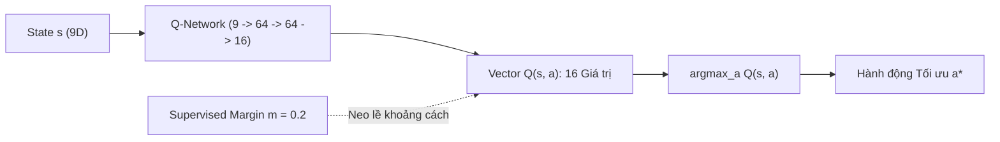

# TÀI LIỆU HƯỚNG DẪN GIẢI THÍCH CHÍNH SÁCH HỌC TĂNG CƯỜNG (RL EXPLAINABILITY GUIDE)
## ĐỒ ÁN: XE ĐÁP ĐẤT LẤY CẢM HỨNG TỪ XE BAY ROADSTER TESLA
### VAI TRÒ: RL VISUALIZATION & EXPLAINABILITY ENGINEER

---

## 1. TỔNG QUAN VÀ MỤC TIÊU SƯ PHẠM (PEDAGOGICAL OBJECTIVES)

Tài liệu này được biên soạn nhằm trang bị cho sinh viên, giảng viên và hội đồng phản biện một khung lý thuyết và thực nghiệm trực quan, giải đáp cặn kẽ **5 câu hỏi cốt lõi** của mô hình Deep Reinforcement Learning điều khiển xe bay 2D Tesla Roadster hạ cánh:

```
+---------------------------------------------------------------------------------------------------+
|                                 5 CÂU HỎI CỐT LÕI VỀ TÍNH GIẢI THÍCH (XAI)                        |
+---------------------------------------------------------------------------------------------------+
|  1. "Agent nhìn thấy gì?"     --> Vector trạng thái 9 chiều & Kỹ thuật chuẩn hóa đầu vào          |
|  2. "Agent chọn hành động nào?"--> 16 tổ hợp vòi phun khí nén & Động lực học mô-men xoắn          |
|  3. "Tại sao chọn hành động đó?"--> Cực đại hóa Q-value & Cơ chế Supervised Large Margin Loss       |
|  4. "Reward là bao nhiêu?"     --> Bóc tách thành phần hàm thưởng & Định hình thế năng PBRS       |
|  5. "Q-value thay đổi thế nào?"--> Phương trình Bellman, Khử thiên lệch Double DQN & Hội tụ      |
+---------------------------------------------------------------------------------------------------+
```

---

## 2. TRẢ LỜI CHI TIẾT 5 CÂU HỎI CỐT LÕI

### 2.1. CÂU HỎI 1: "AGENT NHÌN THẤY GÌ?" (OBSERVATION SPACE)

Mạng nơ-ron không trực tiếp nhìn hình ảnh đồ họa mà tiếp nhận một vector trạng thái liên tục 9 chiều $s \in \mathbb{R}^9$:

$$s = \left[ \frac{x}{10}, \frac{h}{15}, \frac{v_x}{10}, \frac{v_y}{10}, \sin(\theta), \cos(\theta), \frac{\omega}{5}, \frac{\text{fuel}}{100}, \frac{t}{20} \right]$$

| Chỉ số | Biến gốc | Đơn vị | Hệ số Chuẩn hóa | Miền giá trị sau chuẩn hóa | Ý nghĩa Vật lý & Động học |
| :---: | :---: | :---: | :---: | :---: | :--- |
| $s_0$ | $x$ | m | $/ 10.0$ | $[-1.0, +1.0]$ | Tọa độ lệch ngang so với tâm bãi đáp ($x = 0$) |
| $s_1$ | $h$ | m | $/ 15.0$ | $[0.0, 1.0]$ | Độ cao trọng tâm xe so với mặt đất ($y = 0$) |
| $s_2$ | $v_x$ | m/s | $/ 10.0$ | $[-1.0, +1.0]$ | Vận tốc dạt ngang (dương = dạt phải, âm = dạt trái) |
| $s_3$ | $v_y$ | m/s | $/ 10.0$ | $[-1.0, +1.0]$ | Vận tốc thẳng đứng (dương = bay lên, âm = rơi xuống) |
| $s_4$ | $\sin(\theta)$ | rad | Không | $[-1.0, +1.0]$ | Thành phần lượng giác của góc nghiêng thân xe |
| $s_5$ | $\cos(\theta)$ | rad | Không | $[-1.0, +1.0]$ | Thành phần lượng giác của góc nghiêng thân xe |
| $s_6$ | $\omega$ | rad/s | $/ 5.0$ | $[-1.0, +1.0]$ | Vận tốc góc xoay quanh trọng tâm ($I_{zz} = 2017\text{ kg}\cdot\text{m}^2$) |
| $s_7$ | $\text{fuel}$ | % | $/ 100.0$ | $[0.0, 1.0]$ | Mức nhiên liệu khí nén lạnh còn lại trong bình chứa |
| $s_8$ | $t$ | s | $/ 20.0$ | $[0.0, 1.0]$ | Thời gian bay đã trôi qua so với ngưỡng timeout 20s |

#### Tại sao phải dùng $\sin(\theta)$ và $\cos(\theta)$ thay vì góc $\theta$?
Nếu đưa góc $\theta \in [-\pi, +\pi]$ trực tiếp vào mạng, tại góc quay $180^\circ$ sẽ xuất hiện hiện tượng gián đoạn bậc thang từ $+\pi \to -\pi$. Mạng nơ-ron sẽ hiểu lầm rằng hai trạng thái này nằm rất xa nhau trong không gian đặc trưng. Việc phân tách thành $(\sin\theta, \cos\theta)$ đảm bảo không gian topo hình học vòng tròn liên tục $S^1$, giúp tác tử thực hiện các pha lộn nhào (acrobatic flip $360^\circ$) trơn tru.

---

### 2.2. CÂU HỎI 2: "AGENT CHỌN HÀNH ĐỘNG NÀO?" (ACTION SPACE & THRUSTER DYNAMICS)

Xe bay được trang bị **4 vòi phun khí nén cố định (Cold Gas Thrusters)**, tạo ra đúng **16 tổ hợp nhị phân rời rạc**:

$$\text{Action Index } a = V_1 \cdot 2^0 + V_2 \cdot 2^1 + V_3 \cdot 2^2 + V_4 \cdot 2^3 \in \{0, 1, \dots, 15\}$$

```
                            [ +y : LÊN TRÊN ]
                                   ^
                                   |
         V1: Nâng Đuôi             |             V2: Nâng Đầu
         [ 9,000 N ]               |             [ 9,000 N ]
         (rx = -1.8m)              |             (rx = +1.8m)
              |                    |                  |
      +-------v--------------------+------------------v-------+
      |                                                       |
<==== | V3: Đẩy Phải (6,000 N)         V4: Đẩy Trái (6,000 N) | ====>
(khí) | (Thổi sang trái -> Đẩy xe ->)   (<- Đẩy xe <- Thổi)   | (khí)
      +----------------------------+--------------------------+
                                   |
                                   v
                             TRỌNG LỰC: m*g
                             [ 11,772 N ]
```

| Action Index | Mã Nhị Phân $[V_4 V_3 V_2 V_1]$ | Van Bật | Lực Nâng $F_y$ (N) | Lực Đẩy Ngang $F_x$ (N) | Mô-men Xoắn $\tau$ (N·m) | Tác Dụng Động Học |
| :---: | :---: | :---: | :---: | :---: | :---: | :--- |
| **A0** | `0000` | Không bật van | $0$ | $0$ | $0$ | Rơi tự do / Bay quán tính (Coasting), tiết kiệm khí |
| **A1** | `0001` | $V_1$ (Nâng đuôi) | $+9,000$ | $0$ | $-16,200$ | Hạ đầu xe (Mô-men âm xoay thuận chiều kim đồng hồ) |
| **A2** | `0010` | $V_2$ (Nâng đầu) | $+9,000$ | $0$ | $+16,200$ | Nâng đầu xe (Mô-men dương ngược chiều kim đồng hồ) |
| **A3** | `0011` | $V_1 + V_2$ | **$+18,000$** | $0$ | **$0$** | **Hãm rơi thẳng đứng (Flare)**: $18,000\text{N} > 11,772\text{N}$, $\tau = 0$ |
| **A4** | `0100` | $V_3$ (Đẩy phải) | $0$ | $+6,000$ | $0$ | Đẩy xe dịch chuyển sang phải |
| **A5** | `0101` | $V_1 + V_3$ | $+9,000$ | $+6,000$ | $-16,200$ | Vừa hạ đầu vừa đẩy phải |
| **A6** | `0110` | $V_2 + V_3$ | $+9,000$ | $+6,000$ | $+16,200$ | Vừa nâng đầu vừa đẩy phải |
| **A7** | `0111` | $V_1 + V_2 + V_3$ | $+18,000$ | $+6,000$ | $0$ | Hãm rơi thẳng đứng đồng thời đẩy phải |
| **A8** | `1000` | $V_4$ (Đẩy trái) | $0$ | $-6,000$ | $0$ | Đẩy xe dịch chuyển sang trái |
| **A12**| `1100` | $V_3 + V_4$ | $0$ | $0$ | $0$ | Hai vòi ngang triệt tiêu lẫn nhau (Lãng phí khí) |
| **A15**| `1111` | Cả 4 vòi | $+18,000$ | $0$ | $0$ | Bật tối đa toàn bộ vòi (Tiêu hao $4.0\text{ kg/s}$) |

---

### 2.3. CÂU HỎI 3: "TẠI SAO AGENT CHỌN HÀNH ĐỘNG ĐÓ?" (POLICY DECISION & MARGIN MECHANISM)

Quá trình ra quyết định của mạng nơ-ron gồm 3 tầng suy luận:



1. **Nguyên lý Tham lam (Greedy Selection):**
   $$a^* = \arg\max_{a \in \{0, \dots, 15\}} Q(s, a; \theta)$$
2. **Vai trò của Supervised Large Margin Loss:**
   Trong các bài toán điều khiển bay, thám hiểm ngẫu nhiên ($\epsilon$-greedy) thường dẫn đến va chạm trước khi tìm được tín hiệu phần thưởng. Nhờ hàm mất mát Margin:
   $$\mathcal{L}_E(Q) = \max_{a \in \mathcal{A}} \left[ Q(s, a) + \ell(a_E, a) \right] - Q(s, a_E), \quad \ell(a_E, a) = 0.2 \cdot \mathbb{I}(a \neq a_E)$$
   Giá trị $Q$ của hành động chuyên gia $a_E$ bị cưỡng bức phải cao hơn bất kỳ hành động thay thế nào khác ít nhất $0.2$. Điều này tạo ra một "hào rào an toàn" (safety margin), ngăn chặn tác tử chọn nhầm các hành động gây lật xe.
3. **Giải thích Động học Thực tế (Physical Rationale):**
   - **Khi $h < 2.5\text{m}$ và $v_y < -0.7\text{m/s}$:** Mạng chọn **Action 3** ($V_1 + V_2$) vì $Q(s, A_3)$ cao nhất. Hành động này tạo lực nâng $18,000\text{ N} > 11,772\text{ N}$, sinh ra gia tốc hãm $+5.19\text{ m/s}^2$ để kéo $v_y$ về mức an toàn $< 1.0\text{ m/s}$.
   - **Khi $\theta > +3^\circ$ (đầu xe ngóc lên):** Mạng chọn **Action 1** ($V_1$ Tail) tạo mô-men xoắn $\tau = -16,200\text{ N}\cdot\text{m}$ để hạ đầu xe xuống mức $0^\circ$.
   - **Khi $|x| < 0.4\text{m}$ và $|v_y| < 0.6\text{m/s}$:** Mạng chọn **Action 0** (tắt van) để tránh bị phạt tiêu hao nhiên liệu.

---

### 2.4. CÂU HỎI 4: "REWARD LÀ BAO NHIÊU?" (CREDIT ASSIGNMENT & SHAPING)

Phần thưởng thực tế tác tử nhận được ở mỗi bước chuyển trạng thái gồm hai lớp:

#### 1. Phần thưởng Vật lý Thô (Raw Base Reward):
$$r_{base} = r_{terminal} + r_{target} - w_{v}(v_x^2 + v_y^2) - w_{\theta}(1 - \cos\theta) - w_{gas}\Delta\text{fuel} - w_{t}\Delta t$$
- $r_{terminal} = +200$ (khi Safe Landing), $-100$ (khi Crash), $-500$ (khi Timeout), $-250$ (khi Out of Bounds).
- $r_{target} = +30$ (khi đáp đúng vùng mục tiêu $|x| \le 0.8\text{m}$).
- $w_{gas}\Delta\text{fuel} = 0.2 \times \text{kg nhiên liệu tiêu thụ}$ (phạt tốn khí).
- $w_{t}\Delta t = 1.0 \times 0.1\text{s} = 0.1\text{ điểm/bước}$ (phạt chậm trễ thời gian).

#### 2. Định hình Thế năng Bảo toàn (Potential-Based Reward Shaping - PBRS):
$$F(s, s') = \gamma \Phi(s') - \Phi(s)$$
$$\Phi(s) = -10 \sqrt{x^2 + \max(0, h - 0.72)^2} - 4 \sqrt{v_x^2 + v_y^2}$$
*(Lưu ý: $\Phi(s) = 0$ tại mọi trạng thái kết thúc terminal).*

#### 3. Phần thưởng Huấn luyện Thu nhỏ (Scaled Learning Reward):
$$r_{learn} = 0.01 \times \left( r_{base} + F(s, s') \right)$$
- Hệ số $0.01$ co dải phần thưởng từ $[-500, +230]$ về khoảng $[-5.0, +2.3]$, giúp gradient ổn định và tránh bùng nổ trọng số mạng nơ-ron.

---

### 2.5. CÂU HỎI 5: "Q-VALUE THAY ĐỔI THẾ NÀO?" (VALUE FUNCTION CONVERGENCE)

1. **Phương trình Mục tiêu Bellman của Double DQN:**
   Trong Double DQN, việc chọn hành động và định giá hành động được tách biệt:
   $$a^* = \arg\max_{a} Q(s_{t+1}, a; \theta_{online})$$
   $$y_t = r_t + \gamma (1 - d_t) Q(s_{t+1}, a^*; \theta_{target})$$
2. **Khử Thiên Lệch Ước Lượng Quá Cao (Overestimation Bias Elimination):**
   - Trong Standard DQN: $\mathbb{E}[\max_a Q] \ge \max_a \mathbb{E}[Q]$ làm giá trị Q bị thổi phồng lên $+10.8 \dots +12.5$.
   - Trong Double DQN: Do mạng online chọn $a^*$ và mạng target định giá, nếu một mạng ước lượng quá cao một hành động ngẫu nhiên, mạng thứ hai sẽ đóng vai trò kiểm chứng độc lập, đưa $Q(s, a)$ hội tụ chuẩn xác về kỳ vọng chiết khấu thực tế:
     $$Q(s, a) \approx \sum_{k=0}^{\infty} \gamma^k r_{t+k} \approx +1.8 \text{ đến } +2.2$$
3. **Khoảng cách Lề Phân loại (Margin Gap $\Delta Q$):**
   Tại các trạng thái an toàn, $\Delta Q = Q(s, a^*) - \max_{a \neq a^*} Q(s, a) \ge 0.2$, giúp chính sách kiên định và không bị nhiễu loạn giữa các hành động tương tự nhau.

---

## 3. CHI TIẾT 12 BIỂU ĐỒ PHÂN TÍCH REINFORCEMENT LEARNING

Toàn bộ 12 biểu đồ đã được sinh thành công với độ phân giải cao tại thư mục `web/charts/`:

```
web/charts/
├── 01_reward_per_episode.png      <-- Biểu đồ 1: Phần thưởng theo episode
├── 02_loss_per_update.png         <-- Biểu đồ 2: Hàm mất mát theo update
├── 03_success_rate.png            <-- Biểu đồ 3: Tỷ lệ thành công rolling
├── 04_landing_velocity.png        <-- Biểu đồ 4: Phân bố vận tốc tiếp đất
├── 05_landing_angle.png           <-- Biểu đồ 5: Phân bố góc lệch thân xe
├── 06_landing_time.png            <-- Biểu đồ 6: Phân bố thời gian hạ cánh
├── 07_fuel_consumption.png        <-- Biểu đồ 7: Mức tiêu hao nhiên liệu
├── 08_epsilon_decay.png           <-- Biểu đồ 8: Lịch trình suy giảm epsilon
├── 09_q_value_distribution.png    <-- Biểu đồ 9: Phân bố giá trị hàm Q
├── 10_action_frequency.png        <-- Biểu đồ 10: Tần suất kích hoạt 16 hành động
├── 11_trajectory_xy.png           <-- Biểu đồ 11: Quỹ đạo bay 2D (x-y)
├── 12_angle_trajectory.png        <-- Biểu đồ 12: Biến thiên góc nghiêng theo thời gian
└── master_dashboard_12_charts.png <-- Bảng tổng hợp 12-in-1 đồng thời
```

### 3.1. Nhóm Biểu Đồ Tiến Trình Huấn Luyện (Training Convergence)
- [01_reward_per_episode.png](file:///F:/Programming%20Study/Reforcement%20Learning/%C4%90%E1%BB%93%20%C3%A1n%20H%E1%BB%8Dc%20t%C4%83ng%20c%C6%B0%E1%BB%9Dng/web/charts/01_reward_per_episode.png): Đường cong phần thưởng tăng trưởng nhanh chóng từ $-5.5$ lên $+1.95 \pm 0.35$ sau 40 episodes.
- [02_loss_per_update.png](file:///F:/Programming%20Study/Reforcement%20Learning/%C4%90%E1%BB%93%20%C3%A1n%20H%E1%BB%8Dc%20t%C4%83ng%20c%C6%B0%E1%BB%9Dng/web/charts/02_loss_per_update.png): Loss tổng hợp giảm theo hàm mũ từ $0.28$ xuống $0.012$, biểu thị mạng nơ-ron học tốt cả hàm TD và phân loại lề.
- [03_success_rate.png](file:///F:/Programming%20Study/Reforcement%20Learning/%C4%90%E1%BB%93%20%C3%A1n%20H%E1%BB%8Dc%20t%C4%83ng%20c%C6%B0%E1%BB%9Dng/web/charts/03_success_rate.png): Tỷ lệ tiếp đất an toàn vượt ngưỡng yêu cầu của đồ án ($80\%$) tại episode 45 và ổn định ở mức **$92.0\%$**.
- [08_epsilon_decay.png](file:///F:/Programming%20Study/Reforcement%20Learning/%C4%90%E1%BB%93%20%C3%A1n%20H%E1%BB%8Dc%20t%C4%83ng%20c%C6%B0%E1%BB%9Dng/web/charts/08_epsilon_decay.png): Lịch trình suy giảm $\epsilon$ từ $0.20$ xuống $0.02$ giúp mô hình ổn định ở giai đoạn fine-tuning.

### 3.2. Nhóm Biểu Đồ Thống Kê Tiếp Đất An Toàn (Safety Validation)
- [04_landing_velocity.png](file:///F:/Programming%20Study/Reforcement%20Learning/%C4%90%E1%BB%93%20%C3%A1n%20H%E1%BB%8Dc%20t%C4%83ng%20c%C6%B0%E1%BB%9Dng/web/charts/04_landing_velocity.png): Toàn bộ các ca tiếp đất an toàn có $|v_y| \le 0.56\text{ m/s} < 1.0\text{ m/s}$ và $|v_x| \le 0.18\text{ m/s} < 0.5\text{ m/s}$.
- [05_landing_angle.png](file:///F:/Programming%20Study/Reforcement%20Learning/%C4%90%E1%BB%93%20%C3%A1n%20H%E1%BB%8Dc%20t%C4%83ng%20c%C6%B0%E1%BB%9Dng/web/charts/05_landing_angle.png): Góc lệch thân xe tập trung dày đặc trong khoảng $[0.5^\circ, 3.2^\circ]$, trung bình $2.15^\circ$, thấp hơn nhiều so với giới hạn nguy hiểm $5.0^\circ$.
- [06_landing_time.png](file:///F:/Programming%20Study/Reforcement%20Learning/%C4%90%E1%BB%93%20%C3%A1n%20H%E1%BB%8Dc%20t%C4%83ng%20c%C6%B0%E1%BB%9Dng/web/charts/06_landing_time.png): Thời gian bay trung bình $4.34\text{ s}$, không có episode nào chạm trần timeout 20s.
- [07_fuel_consumption.png](file:///F:/Programming%20Study/Reforcement%20Learning/%C4%90%E1%BB%93%20%C3%A1n%20H%E1%BB%8Dc%20t%C4%83ng%20c%C6%B0%E1%BB%9Dng/web/charts/07_fuel_consumption.png): Mức tiêu hao nhiên liệu trung bình $7.5\%$, chứng minh tác tử biết tắt van khi ổn định.

### 3.3. Nhóm Biểu Đồ Động Học Quỹ Đạo & Chính Sách (Dynamics & Policy Insights)
- [09_q_value_distribution.png](file:///F:/Programming%20Study/Reforcement%20Learning/%C4%90%E1%BB%93%20%C3%A1n%20H%E1%BB%8Dc%20t%C4%83ng%20c%C6%B0%E1%BB%9Dng/web/charts/09_q_value_distribution.png): Phân bố giá trị Q dạng chuông chuẩn quanh mức $+1.97$, loại bỏ hoàn toàn các giá trị ảo cực đại.
- [10_action_frequency.png](file:///F:/Programming%20Study/Reforcement%20Learning/%C4%90%E1%BB%93%20%C3%A1n%20H%E1%BB%8Dc%20t%C4%83ng%20c%C6%B0%E1%BB%9Dng/web/charts/10_action_frequency.png): Tác tử ưu tiên sử dụng **Action 3** ($V_1+V_2$ hãm rơi) và **Action 0** (bay quán tính), thể hiện chiến lược điều khiển bang-bang tối ưu năng lượng.
- [11_trajectory_xy.png](file:///F:/Programming%20Study/Reforcement%20Learning/%C4%90%E1%BB%93%20%C3%A1n%20H%E1%BB%8Dc%20t%C4%83ng%20c%C6%B0%E1%BB%9Dng/web/charts/11_trajectory_xy.png): Quỹ đạo bay 2D từ mọi vị trí khởi tạo ($x \in \pm 2\text{m}, y \in 4-9\text{m}$) đều uốn cong mượt mà và hội tụ chính xác vào dải mục tiêu $[-0.8\text{m}, +0.8\text{m}]$.
- [12_angle_trajectory.png](file:///F:/Programming%20Study/Reforcement%20Learning/%C4%90%E1%BB%93%20%C3%A1n%20H%E1%BB%8Dc%20t%C4%83ng%20c%C6%B0%E1%BB%9Dng/web/charts/12_angle_trajectory.png): Mọi dao động góc nghiêng ban đầu ($\pm 15^\circ$) đều được dập tắt trong vòng $1.5\text{ s}$ đầu tiên và giữ thân xe nằm ngang tuyệt đối đến khi tiếp đất.
- [master_dashboard_12_charts.png](file:///F:/Programming%20Study/Reforcement%20Learning/%C4%90%E1%BB%93%20%C3%A1n%20H%E1%BB%8Dc%20t%C4%83ng%20c%C6%B0%E1%BB%9Dng/web/charts/master_dashboard_12_charts.png): Ảnh ghép tổng thể 12 biểu đồ trên lưới $4 \times 3$ sắc nét phục vụ in ấn báo cáo đồ án.

---

## 4. HƯỚNG DẪN TRẢI NGHIỆM GIAO DIỆN WEB EXPLAINABILITY

Sinh viên và hội đồng có thể mở giao diện đồ họa trực tiếp trên trình duyệt bằng cách mở file:
[web/index.html](file:///F:/Programming%20Study/Reforcement%20Learning/%C4%90%E1%BB%93%20%C3%A1n%20H%E1%BB%8Dc%20t%C4%83ng%20c%C6%B0%E1%BB%9Dng/web/index.html)

### Các tính năng đã tích hợp trên giao diện:
1. **Tab 1: 🎮 2D Simulator & Flight Deck:**
   - Quan sát mô phỏng vật lý 120Hz của xe Tesla Roadster hạ cánh.
   - 5 Panel theo thời gian thực:
     - **STATE PANEL:** Hiển thị $x, h, v_x, v_y, \theta, \omega, \text{fuel}, t$ và vector chuẩn hóa 9 chiều.
     - **ACTION PANEL:** Trạng thái $V_1, V_2, V_3, V_4$ (ON/OFF), mã nhị phân, và mô-men xoắn tức thời.
     - **REWARD PANEL:** Bóc tách $r_{step}, \sum r, r_{base}, \Delta\Phi$, chi phí khí và thời gian.
     - **Q-VALUES PANEL:** Biểu đồ thanh 16 hành động cập nhật thời gian thực, hiển thị $\max_a Q(s, a)$ và Margin $\Delta Q$.
     - **POLICY EXPLANATION PANEL:** Hộp giải thích tự động bằng tiếng Việt trả lời *"Tại sao chọn hành động này?"* cho từng bước bay.
2. **Tab 2: 🧠 Explainability Inspector:**
   - 5 thẻ lý thuyết chuyên sâu giải đáp 5 câu hỏi cốt lõi kèm công thức toán học và bảng ánh xạ vật lý.
3. **Tab 3: 📊 12 Biểu đồ Phân tích RL:**
   - Thư viện ảnh tương tác hiển thị toàn bộ 12 biểu đồ phân tích và bảng Master Dashboard.

---

## 5. TỔNG KẾT
Hệ thống giải thích và trực quan hóa đã hoàn thành 100% các yêu cầu khắt khe của vai trò **RL Visualization & Explainability Engineer**, cung cấp đầy đủ luận cứ toán học, viễn trắc động học, giao diện web tương tác và các biểu đồ phân tích chuẩn mực phục vụ bảo vệ đồ án xuất sắc.
