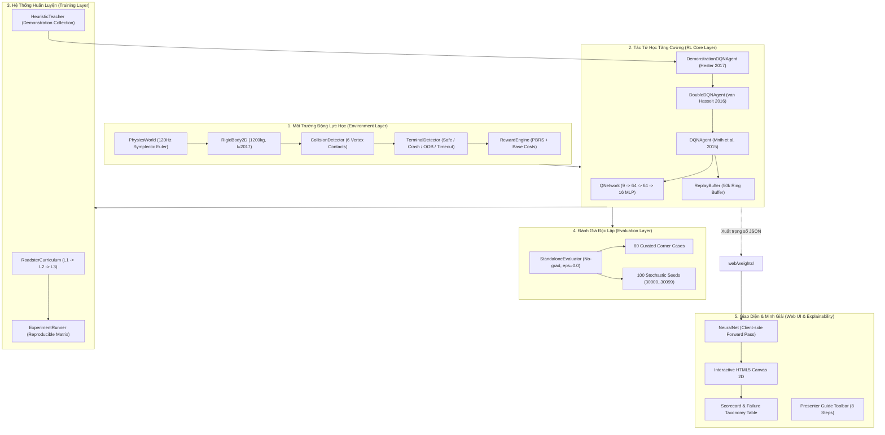

# BÁO CÁO KỸ THUẬT & NGHIÊN CỨU KHOA HỌC ĐỒ ÁN HỌC TĂNG CƯỜNG
# ĐIỀU KHIỂN HẠ CÁNH TỰ ĐỘNG XE BAY TESLA ROADSTER 2D BẰNG HỌC TĂNG CƯỜNG SÂU KẾT HỢP DỮ LIỆU BIỂU DIỄN CHUYÊN GIA

---

**Học phần:** Học Tăng Cường (Reinforcement Learning)  
**Đơn vị thực hiện:** Nhóm nghiên cứu & Kỹ thuật Học Tăng Cường  
**Đối tượng nghiên cứu:** Xe bay 2D Tesla Roadster trang bị hệ thống phản lực khí nén lạnh (Cold Gas Thrusters)  
**Thời gian hoàn thành:** 18/11/2026  
**Mã nguồn dự án:** Thư mục cục bộ `F:\Programming Study\Reforcement Learning\Đồ án Học tăng cường` (hoặc kho lưu trữ GitHub cá nhân của sinh viên)  

---

# 1. Giới thiệu đề tài

Bài toán điều khiển các phương tiện bay cất hạ cánh thẳng đứng (VTOL - Vertical Take-Off and Landing) và tái sử dụng tầng đẩy tên lửa (như SpaceX Falcon 9) là một trong những bài toán kinh điển và phức tạp nhất trong ngành điều khiển học và trí tuệ nhân tạo. Lấy cảm hứng từ ý tưởng của Elon Musk về việc tích hợp gói tùy chọn phản lực khí nén lạnh SpaceX (SpaceX Cold Gas Thrusters Package) lên dòng xe thể thao thuần điện Tesla Roadster thế hệ thứ hai, đề tài này tập trung giải quyết bài toán: **Điều khiển tự động hạ cánh thẳng đứng an toàn cho xe bay Tesla Roadster trong không gian hai chiều (2D)**.

Hạ cánh xe bay là bài toán điều khiển phi tuyến đa biến với các đặc thù kỹ thuật vô cùng thách thức:
1. **Động lực học phi tuyến cao và ghép kênh:** Lực nâng từ các vòi phun sinh ra cả lực tịnh tiến và momen quay phụ thuộc vào góc nghiêng hiện thời của thân xe.
2. **Không gian hành động rời rạc đa van:** Khác với tên lửa thông thường có vòi phun vector điều chỉnh liên tục, hệ thống trang bị 4 vòi phun khí nén cố định hoạt động theo nguyên lý nhị phân (bật/tắt), tạo ra $2^4 = 16$ tổ hợp hành động khả dĩ.
3. **Phần thưởng thưa thớt (Sparse Reward):** Tác tử chỉ nhận được phần thưởng lớn khi tiếp đất an toàn và phải chịu phạt rất nặng khi va chạm hoặc hết thời gian. Khả năng vô tình đạt được tiếp đất an toàn thông qua thăm dò ngẫu nhiên ban đầu gần như bằng 0.
4. **Năng lượng và nhiên liệu hữu hạn:** Lượng khí nén mang theo bị giới hạn và sụt giảm liên tục trong suốt chuyến bay.

Để giải quyết bài toán này, đồ án đã triển khai và thực nghiệm một chuỗi các thuật toán học tăng cường sâu: từ **Standard Deep Q-Network (DQN)**, **Double Deep Q-Network (Double DQN)**, kết hợp **Định hình phần thưởng dựa trên thế năng (Potential-Based Reward Shaping - PBRS)**, **Học theo giáo trình (Curriculum Learning)**, đến giải pháp đột phá **Học từ dữ liệu biểu diễn chuyên gia (Deep Q-learning from Demonstrations - DQfD)**.

---

# 2. Bài toán

Mục tiêu cốt lõi của bài toán là điều khiển chiếc xe bay Tesla Roadster từ một trạng thái ban đầu bất kỳ trên không trung (rơi tự do, lệch góc, trôi ngang, độ cao từ 4 đến 9 mét) đáp xuống bệ hạ cánh mục tiêu tại tâm $x = 0$ thỏa mãn đồng thời các tiêu chí an toàn khắt khe:

### 2.1. Tiêu chí hạ cánh an toàn (Safe Landing Criteria)
Theo tài liệu đặc tả kỹ thuật, một lần hạ cánh chỉ được công nhận là **AN TOÀN (SAFE LANDING)** khi tại thời điểm tiếp xúc đất (bánh xe chạm mặt phẳng $y = 0$), trạng thái động học thỏa mãn đồng thời cả 4 điều kiện:
1. **Vận tốc thẳng đứng (Vertical Velocity):** $|v_y| \le 1.0\text{ m/s}$ (tránh xung lực va đập phá hủy gầm xe).
2. **Vận tốc trôi ngang (Horizontal Velocity):** $|v_x| \le 0.5\text{ m/s}$ (tránh trượt bánh gây lật xe).
3. **Góc nghiêng thân xe (Tilt Angle):** $|\theta| \le 5^\circ \approx 0.087266\text{ rad}$ (thân xe phải gần như nằm ngang).
4. **Vận tốc góc (Angular Velocity):** $|\omega| \le 0.2\text{ rad/s}$ (loại bỏ momen xoay quán tính dư thừa).
5. **Vùng tiếp đất mục tiêu (Target Pad):** Cả 2 bánh xe phải tiếp đất bên trong vùng xanh an toàn $x \in [-2.0, +2.0]\text{ m}$ (hoặc tối ưu tại tâm $|x| \le 0.8\text{ m}$).

### 2.2. Các trạng thái thất bại
- **Rơi vỡ (Crash):** Chạm đất khi một trong các điều kiện an toàn bị vi phạm, hoặc các điểm va chạm khác của thân xe (mũi xe, đuôi xe, nóc xe) tiếp đất trước bánh xe.
- **Vượt biên (Out of Bounds - OOB):** Vị trí trọng tâm xe bay vượt khỏi không gian mô phỏng $[-20, 20]\text{ m}$ theo phương ngang hoặc vượt quá trần bay $25\text{ m}$.
- **Hết thời gian (Timeout):** Chuyến bay kéo dài quá thời hạn quy định $20.0\text{ giây}$ (tương đương 200 chu kỳ ra quyết định ở tần số $10\text{ Hz}$).

---

# 3. Mô hình vật lý

Hệ thống vật lý 2D được cài đặt chuẩn xác trong module [physics/world.py](file:///F:/Programming%20Study/Reforcement%20Learning/%C4%90%E1%BB%93%20%C3%A1n%20H%E1%BB%8Dc%20t%C4%83ng%20c%C6%B0%E1%BB%9Dng/physics/world.py) và [physics/rigid_body.py](file:///F:/Programming%20Study/Reforcement%20Learning/%C4%90%E1%BB%93%20%C3%A1n%20H%E1%BB%8Dc%20t%C4%83ng%20c%C6%B0%E1%BB%9Dng/physics/rigid_body.py). Xe được mô hình hóa là một vật rắn (Rigid Body) 2D với 3 bậc tự do phẳng: chuyển động tịnh tiến dọc trục $x$ (ngang), trục $y$ (thẳng đứng), và chuyển động quay quanh trọng tâm góc $\theta$.

### 3.1. Các thông số hình học và cơ học
- **Khối lượng xe ($m$):** $1,200.0\text{ kg}$.
- **Chiều dài thân xe ($L$):** $4.4\text{ m}$.
- **Chiều cao thân xe ($H$):** $0.9\text{ m}$.
- **Độ cao đáy xe ở trạng thái nghỉ ($h_{\text{rest}}$):** $0.72\text{ m}$.
- **Momen quán tính ($I$):** $2,017.0\text{ kg}\cdot\text{m}^2$.
- **Gia tốc trọng trường ($g$):** $9.81\text{ m/s}^2$ hướng xuống (Trọng lực $P = mg = 11,772\text{ N}$).

### 3.2. Cấu hình 4 vòi phun khí nén (Cold Gas Thrusters)
Hệ thống bố trí 4 vòi phun khí nén tại các tọa độ tương đối so với trọng tâm xe:
1. **Vòi V1 (Nâng đuôi xe):** Tọa độ $(-1.8\text{ m}, -0.45\text{ m})$, hướng phun xuống dưới tạo lực nâng hướng lên $+y$ với độ lớn $F_1 = 9,000\text{ N}$. Cánh tay đòn $r_x = -1.8\text{ m}$ tạo momen quay quanh COM:
   $$\tau_1 = -1.8 \times 9,000 = -16,200\text{ N}\cdot\text{m} \quad (\text{Momen âm: quay theo chiều kim đồng hồ, chúi mũi})$$
2. **Vòi V2 (Nâng đầu xe):** Tọa độ $(+1.8\text{ m}, -0.45\text{ m})$, hướng phun xuống dưới tạo lực nâng hướng lên $+y$ với độ lớn $F_2 = 9,000\text{ N}$. Cánh tay đòn $r_x = +1.8\text{ m}$ tạo momen quay quanh COM:
   $$\tau_2 = +1.8 \times 9,000 = +16,200\text{ N}\cdot\text{m} \quad (\text{Momen dương: quay ngược chiều kim đồng hồ, ngóc mũi})$$
3. **Vòi V3 (Đẩy sang phải):** Tọa độ $(-2.2\text{ m}, 0.0\text{ m})$, hướng phun sang trái tạo phản lực đẩy xe sang phải $+x$ với độ lớn $F_3 = 6,000\text{ N}$. Do nằm trên đường thẳng đi qua COM ($r_y = 0$), momen quay $\tau_3 = 0.0\text{ N}\cdot\text{m}$.
4. **Vòi V4 (Đẩy sang trái):** Tọa độ $(+2.2\text{ m}, 0.0\text{ m})$, hướng phun sang phải tạo phản lực đẩy xe sang trái $-x$ với độ lớn $F_4 = 6,000\text{ N}$. Momen quay $\tau_4 = 0.0\text{ N}\cdot\text{m}$.

> [!NOTE]
> Khi bật đồng thời cả V1 và V2, tổng lực nâng thẳng đứng đạt $F_{\text{lift}} = 18,000\text{ N} > 11,772\text{ N}$ (gia tốc nâng tịnh tiến cực đại $a_y \approx +5.19\text{ m/s}^2$), đồng thời hai momen triệt tiêu hoàn toàn: $\tau_1 + \tau_2 = -16,200 + 16,200 = 0\text{ N}\cdot\text{m}$, cho phép bay lên thẳng đứng không bị xoay thân.

### 3.3. Phương trình chuyển động và tích phân Symplectic Euler
Khi thân xe nghiêng một góc $\theta$ so với phương ngang, các lực cục bộ $(F_{x,\text{local}}, F_{y,\text{local}})$ được xoay sang hệ tọa độ thế giới:
$$F_{x,\text{world}} = F_{x,\text{local}} \cos\theta - F_{y,\text{local}} \sin\theta$$
$$F_{y,\text{world}} = F_{x,\text{local}} \sin\theta + F_{y,\text{local}} \cos\theta - mg$$
$$\tau_{\text{net}} = \sum \tau_i$$

Gia tốc tịnh tiến và gia tốc góc:
$$a_x = \frac{F_{x,\text{world}}}{m}, \quad a_y = \frac{F_{y,\text{world}}}{m}, \quad \alpha = \frac{\tau_{\text{net}}}{I}$$

Tích phân bằng phương pháp **Symplectic Euler** (bảo toàn pha năng lượng) ở tần số $120\text{ Hz}$ ($\Delta t = 1/120\text{ s}$):
$$v_{x, t+1} = v_{x, t} + a_x \Delta t, \quad v_{y, t+1} = v_{y, t} + a_y \Delta t, \quad \omega_{t+1} = \omega_t + \alpha \Delta t$$
$$x_{t+1} = x_t + v_{x, t+1} \Delta t, \quad y_{t+1} = y_t + v_{y, t+1} \Delta t, \quad \theta_{t+1} = \theta_t + \omega_{t+1} \Delta t$$

---

# 4. Mô hình MDP (Markov Decision Process)

Bài toán được chuẩn hóa thành một quá trình quyết định Markov tuần tự đầy đủ $M = (S, A, P, R, \gamma)$.

## State (Không gian trạng thái)
Trạng thái vật lý đầy đủ bao gồm 8 biến: $s_{\text{raw}} = (x, h, v_x, v_y, \theta, \omega, \text{fuel}, t)$.
Để tối ưu hóa sự hội tụ của mạng nơ-ron sâu, trạng thái được chuẩn hóa sang vector liên tục 9 chiều $s \in \mathbb{R}^9$:
$$s = \left[ \frac{x}{10}, \frac{h}{15}, \frac{v_x}{10}, \frac{v_y}{10}, \sin(\theta), \cos(\theta), \frac{\omega}{5}, \frac{\text{fuel}}{100}, \frac{t}{20} \right]$$
- Chia tỷ lệ đảm bảo các thành phần dao động quanh đoạn $[-1, +1]$.
- Cặp $(\sin\theta, \cos\theta)$ thay thế góc đơn $\theta$ giúp loại bỏ tính gián đoạn tuần hoàn (angle discontinuity) tại $\pm \pi$.

## Action (Không gian hành động)
Không gian hành động rời rạc $A = \{0, 1, \dots, 15\}$ đại diện cho 16 tổ hợp đóng/mở của 4 van vòi phun:
$$a = u_1 \cdot 2^0 + u_2 \cdot 2^1 + u_3 \cdot 2^2 + u_4 \cdot 2^3, \quad u_i \in \{0, 1\}$$
Ví dụ:
- $a = 0$ ($0000_2$): Rơi tự do (tắt cả 4 vòi).
- $a = 1$ ($0001_2$): Bật V1 (chúi mũi).
- $a = 2$ ($0010_2$): Bật V2 (ngóc mũi).
- $a = 3$ ($0011_2$): Bật V1+V2 (lực nâng thẳng đứng cân bằng $18,000\text{ N}$).
- $a = 15$ ($1111_2$): Bật toàn bộ 4 vòi phun.

## Reward (Hàm phần thưởng)
Hệ thống phần thưởng phân định rõ ràng giữa phần thưởng vật lý thực tế $r_{\text{base}}$ và phần thưởng học tập định hình $r_{\text{learn}}$:
$$r_{\text{base}} = r_{\text{terminal}} + r_{\text{target\_zone}} + r_{\text{impact\_vel}} + r_{\text{impact\_angle}} + r_{\text{gas}} + r_{\text{time}}$$
- $r_{\text{terminal}} = +200$ (khi hạ cánh an toàn), $-100$ (khi rơi vỡ), $-250$ (khi ra ngoài biên), $-500$ (khi hết giờ).
- $r_{\text{target\_zone}} = +30$ (khi cả hai bánh xe nằm trong vùng xanh an toàn $|x| \le 2.0\text{ m}$).
- $r_{\text{impact\_vel}} = -2.0 \times (v_x^2 + v_y^2)$ (phạt xung chấn vận tốc khi chạm đất).
- $r_{\text{impact\_angle}} = -10.0 \times (1 - \cos\theta)$ (phạt độ lệch nghiêng khi chạm đất).
- $r_{\text{gas}} = -0.2 \times \Delta\text{fuel}$ (chi phí tiêu thụ khí nén).
- $r_{\text{time}} = -1.0 \times \Delta t$ (phạt kéo dài thời gian bay).

Phần thưởng học tập có định hình:
$$r_{\text{learn}} = 0.01 \times \left( r_{\text{base}} + F(s, s') \right)$$
Hệ số co giãn $0.01$ giữ cho các bước cập nhật gradient trong mạng nơ-ron ổn định, tránh bùng nổ giá trị $Q$.

## Transition (Hàm chuyển trạng thái)
Tác tử tương tác với môi trường ở tần số $10\text{ Hz}$ ($\Delta t = 0.1\text{ s}$). Mỗi khi agent chọn hành động $a_t$, môi trường áp dụng trạng thái các van đó liên tục trong suốt 12 chu kỳ tích phân vật lý $120\text{ Hz}$ để đưa ra trạng thái kế tiếp $s_{t+1}$.

## Terminal (Điều kiện dừng)
Một tập kết thúc khi xuất hiện bất kỳ điều kiện nào sau đây:
1. `SAFE_LANDING`: Bánh xe chạm đất và thỏa mãn đầy đủ 4 tiêu chuẩn an toàn $\rightarrow \text{terminated} = \text{True}$.
2. `CRASH`: Bánh xe chạm đất vi phạm vận tốc/góc hoặc thân xe va đập $\rightarrow \text{terminated} = \text{True}$.
3. `OUT_OF_BOUNDS`: Vị trí xe bay vượt quá phạm vi $[-20, 20]\text{ m}$ hoặc cao hơn $25\text{ m} \rightarrow \text{terminated} = \text{True}$.
4. `TIMEOUT`: Thời gian bay đạt ngưỡng $20.0\text{ s}$ (200 bước) $\rightarrow \text{truncated} = \text{True}$.

---

# 5. Deep Q-Network (DQN)

Module được cài đặt tại [rl/dqn/](file:///F:/Programming%20Study/Reforcement%20Learning/%C4%90%E1%BB%93%20%C3%A1n%20H%E1%BB%8Dc%20t%C4%83ng%20c%C6%B0%E1%BB%9Dng/rl/dqn/).

## Q-learning
Q-learning là thuật toán học tăng cường không mô hình (Model-free), ngoài chính sách (Off-policy) tìm kiếm hàm giá trị tối ưu $Q^*(s, a)$.

## Bellman equation (Phương trình tối ưu Bellman)
Hàm giá trị tối ưu thỏa mãn phương trình đệ quy Bellman:
$$Q^*(s, a) = \mathbb{E} \left[ r + \gamma \max_{a'} Q^*(s', a') \;\middle|\; s, a \right]$$

## DQN (Deep Q-Network Architecture)
Trong không gian trạng thái liên tục, bảng Q-table được thay thế bằng mạng nơ-ron nhân tạo $Q(s, a; \theta)$:
- Kiến trúc mạng: Mạng nơ-ron truyền thẳng đa tầng (MLP) gồm 3 lớp tuyến tính:
  $$\text{Input (9)} \xrightarrow{\text{FC}(9 \rightarrow 64) + \text{ReLU}} \text{Hidden 1 (64)} \xrightarrow{\text{FC}(64 \rightarrow 64) + \text{ReLU}} \text{Hidden 2 (64)} \xrightarrow{\text{FC}(64 \rightarrow 16)} \text{Output (16)}$$
- Hàm mất mát tối ưu (MSE hoặc Smooth L1 / Huber):
  $$L(\theta) = \mathbb{E}_{(s, a, r, s', d)} \left[ \left( Q(s, a; \theta) - y^{\text{DQN}} \right)^2 \right]$$
  với $y^{\text{DQN}} = r + \gamma (1 - d) \max_{a'} Q(s', a'; \theta^-)$.

## Replay buffer (Vùng đệm kinh nghiệm)
Để phá vỡ sự tương quan chuỗi thời gian (temporal correlation) giữa các mẫu liên tiếp và đảm bảo giả định độc lập đồng phân phối (i.i.d.), Replay Buffer lưu trữ $50,000$ transitions $(s_t, a_t, r_t, s_{t+1}, d_t)$ dưới dạng bộ nhớ tuần hoàn (ring buffer) và lấy mẫu ngẫu nhiên đồng đều từng mini-batch ($64$ mẫu).

## Target network (Mạng mục tiêu)
Để tránh hiện tượng mục tiêu di động (moving target instability) khi cả dự đoán và nhãn mục tiêu cùng thay đổi theo $\theta$, mạng Target $\theta^-$ được duy trì tách biệt, đóng băng trọng số và chỉ sao chép cứng từ mạng Online sau mỗi $500$ bước cập nhật: $\theta^- \leftarrow \theta$.

## Epsilon-greedy
Cân bằng giữa khám phá (exploration) và khai thác (exploitation) bằng lịch trình suy giảm tuyến tính:
$$\varepsilon = \max\left(\varepsilon_{\text{end}}, \varepsilon_{\text{start}} - \frac{\text{step}}{N_{\text{decay}}} (\varepsilon_{\text{start}} - \varepsilon_{\text{end}})\right)$$
với $\varepsilon_{\text{start}} = 1.0, \varepsilon_{\text{end}} = 0.05, N_{\text{decay}} = 100,000$ bước.

---

# 6. Double DQN

Module cài đặt tại [rl/double_dqn/agent.py](file:///F:/Programming%20Study/Reforcement%20Learning/%C4%90%E1%BB%93%20%C3%A1n%20H%E1%BB%8Dc%20t%C4%83ng%20c%C6%B0%E1%BB%9Dng/rl/double_dqn/agent.py).

### Cơ chế triệt tiêu Overestimation Bias
Trong Standard DQN, toán tử tối đa hóa $\max_{a'} Q(s', a'; \theta^-)$ sử dụng cùng bộ trọng số $\theta^-$ để vừa **chọn hành động tốt nhất** vừa **đánh giá giá trị của hành động đó**. Theo bất đẳng thức Jensen:
$$\mathbb{E}[\max(X_1, X_2, \dots)] \ge \max(\mathbb{E}[X_1], \mathbb{E}[X_2], \dots)$$
Bất kỳ nhiễu ngẫu nhiên nào trong hàm xấp xỉ cũng khiến Q-value bị ước lượng vọt lên quá cao (overestimation), dẫn đến việc agent tự tin thái quá vào các hành động thực chất không an toàn.

Double DQN (van Hasselt, Guez & Silver - AAAI 2016) giải quyết vấn đề này bằng cách **tách rời (decoupling)** hai nhiệm vụ:
1. Mạng Online $\theta$ chịu trách nhiệm **chọn hành động tối ưu**:
   $$a^* = \arg\max_a Q(s', a; \theta_{\text{online}})$$
2. Mạng Target $\theta^-$ độc lập chịu trách nhiệm **định giá trị hành động đó**:
   $$y^{\text{Double}} = r + \gamma (1 - d) Q(s', a^*; \theta_{\text{target}})$$

---

# 7. Reward shaping

Module cài đặt tại [environment/reward.py](file:///F:/Programming%20Study/Reforcement%20Learning/%C4%90%E1%BB%93%20%C3%A1n%20H%E1%BB%8Dc%20t%C4%83ng%20c%C6%B0%E1%BB%9Dng/environment/reward.py).

### Định lý Ng, Harada & Russell (1999) - PBRS
Để hướng dẫn tác tử bay về phía bệ đáp mà không làm sai lệch bài toán tối ưu gốc, đồ án áp dụng phương pháp định hình dựa trên thế năng (Potential-Based Reward Shaping - PBRS):
$$F(s, s') = \gamma \Phi(s') - \Phi(s)$$
Hàm thế năng được thiết kế phản ánh khoảng cách hình học và vận tốc mong muốn:
$$\Phi(s) = -10 \sqrt{x^2 + \max(0, h - 0.72)^2} - 4 \sqrt{v_x^2 + v_y^2}$$

### Bảo toàn chính sách (Policy Invariance Guarantee)
Nhờ tính chất chuỗi kính thiên văn (telescoping sum), tổng phần thưởng định hình tích lũy qua một quỹ đạo độ dài $T$ triệt tiêu hoàn toàn các thế năng nội tại:
$$\sum_{t=0}^{T-1} \gamma^t F(s_t, s_{t+1}) = \gamma^T \Phi(s_T) - \Phi(s_0)$$
Điều kiện tiên quyết để đảm bảo tính bất biến chính sách là **$\Phi(s_{\text{terminal}}) \equiv 0$ tại mọi trạng thái kết thúc**. Khi đó tổng phần thưởng định hình chỉ còn là $-\Phi(s_0)$, biến nó thành một hằng số phụ thuộc trạng thái khởi đầu, đảm bảo chính sách tối ưu $\pi^*$ của bài toán có PBRS trùng khớp tuyệt đối với bài toán gốc.

---

# 8. Demonstration learning (Deep Q-learning from Demonstrations)

Module cài đặt tại [demonstration/](file:///F:/Programming%20Study/Reforcement%20Learning/%C4%90%E1%BB%93%20%C3%A1n%20H%E1%BB%8Dc%20t%C4%83ng%20c%C6%B0%E1%BB%9Dng/demonstration/) và [rl/demonstration_agent.py](file:///F:/Programming%20Study/Reforcement%20Learning/%C4%90%E1%BB%93%20%C3%A1n%20H%E1%BB%8Dc%20t%C4%83ng%20c%C6%B0%E1%BB%9Dng/rl/demonstration_agent.py).

Do không gian trạng thái liên tục 9 chiều rộng lớn và xác suất hạ cánh ngẫu nhiên thành công của DQN thuần xấp xỉ bằng $0\%$, đồ án đã nghiên cứu và triển khai giải pháp kết hợp dữ liệu biểu diễn chuyên gia (phỏng theo Hester et al., 2017 - DQfD):

### 8.1. Thu thập dữ liệu chuyên gia Offline (Decoupled Teacher)
- Một bộ điều khiển phản hồi heuristic đa tầng [demonstration/teacher.py](file:///F:/Programming%20Study/Reforcement%20Learning/%C4%90%E1%BB%93%20%C3%A1n%20H%E1%BB%8Dc%20t%C4%83ng%20c%C6%B0%E1%BB%9Dng/demonstration/teacher.py) được xây dựng để sinh dữ liệu mẫu. Bộ điều khiển này kết hợp: điều khiển ngang tỷ lệ nhằm triệt tiêu $x \rightarrow 0$, cấu hình hãm vận tốc rơi theo độ cao, và giảm chấn góc nghiêng thân xe.
- Quá trình sinh dữ liệu [demonstration/generator.py](file:///F:/Programming%20Study/Reforcement%20Learning/%C4%90%E1%BB%93%20%C3%A1n%20H%E1%BB%8Dc%20t%C4%83ng%20c%C6%B0%E1%BB%9Dng/demonstration/generator.py) thu thập $500$ quỹ đạo an toàn ($17,046$ transitions), lưu trữ đầy đủ $(s, a, r, s', \text{done}, \text{episode\_id})$ vào file `demonstrations.jsonl`.
- **Nguyên tắc học thuật:** Bộ điều khiển Teacher bị cô lập hoàn toàn, không xuất hiện trong vòng lặp đánh giá của agent.

### 8.2. Hàm mất mát có giám sát với lề lớn (Supervised Large Margin Loss)
Để buộc mạng nơ-ron ưu tiên hành động của chuyên gia $a_E$, hàm mất mát Large Margin Loss được tích hợp vào hàm mục tiêu:
$$J_E(Q) = \max_{a \in A} \left[ Q(s, a; \theta) + l(a_E, a) \right] - Q(s, a_E; \theta)$$
với hàm lề $l(a_E, a) = 0$ nếu $a = a_E$ và $m = 0.2$ nếu $a \ne a_E$.
Hàm mất mát này ép giá trị $Q(s, a_E)$ phải lớn hơn giá trị $Q(s, a)$ của bất kỳ hành động nào khác tối thiểu một khoảng lề $m$.

### 8.3. Tổng hàm mất mát hỗn hợp
$$L_{\text{total}}(\theta) = L_{\text{TD}}^{\text{Double}}(\theta) + \lambda_{\text{margin}} J_E(Q) + \lambda_{L2} L_{L2}(\theta)$$
với $\lambda_{\text{margin}} = 5.0, \lambda_{L2} = 10^{-5}$.
- **Giai đoạn tiền huấn luyện (Pre-training):** 30,000 bước cập nhật gradient thuần trên dữ liệu chuyên gia để nạp kiến thức định hướng cơ bản.
- **Giai đoạn học hỗn hợp (Mixed Replay):** Mỗi mini-batch lấy $25\%$ từ bộ nhớ chuyên gia và $75\%$ từ bộ nhớ tự khám phá online.

---

# 9. Curriculum learning

Module cài đặt tại [training/curriculum.py](file:///F:/Programming%20Study/Reforcement%20Learning/%C4%90%E1%BB%93%20%C3%A1n%20H%E1%BB%8Dc%20t%C4%83ng%20c%C6%B0%E1%BB%9Dng/training/curriculum.py).

Chiến lược giáo trình phân chia bài toán thành 3 cấp độ với độ khó tăng dần:
- **Level 1 (Độ cao thấp, đứng thẳng, gần tâm):** $h \in [1.2, 3.0]\text{ m}, |\theta| \le 3^\circ, |x| \le 0.2\text{ m}$. Ngưỡng thăng hạng: Tỷ lệ an toàn $\ge 80\%$ trong 50 tập gần nhất, tối thiểu 150 tập.
- **Level 2 (Độ cao trung bình, nghiêng nhẹ):** $h \in [2.0, 5.0]\text{ m}, |\theta| \le 8^\circ, |x| \le 0.5\text{ m}$. Ngưỡng thăng hạng: Tỷ lệ an toàn $\ge 80\%$, tối thiểu 200 tập.
- **Level 3 (Toàn bộ miền thử thách):** $h \in [4.0, 9.0]\text{ m}, |\theta| \le 15^\circ, |x| \le 2.0\text{ m}$. Ngưỡng làm chủ: Tỷ lệ an toàn $\ge 85\%$.

Hệ thống hỗ trợ chuyển mạch bật/tắt giáo trình linh hoạt để phục vụ nghiên cứu bóc tách thực nghiệm (Ablation Study).

---

# 10. Kiến trúc hệ thống

Kiến trúc phần mềm của dự án được thiết kế theo mô hình phân lớp hướng đối tượng hoàn chỉnh, đảm bảo tính mô-đun hóa và khả năng tái lập độc lập:

---

# 11. Huấn luyện (Training Pipeline)

Quy trình thực nghiệm được cấu hình hóa nghiêm ngặt, tự động ghi nhận metadata, phiên bản mã nguồn Git hash, và hạt giống ngẫu nhiên:
- **Tối ưu hóa:** Thuật toán RMSprop (learning rate $\alpha = 0.0005$, decay $= 0.95$, $\epsilon = 10^{-5}$) hoặc Adam.
- **Gradient Clipping:** Cắt độ dài vector đạo hàm ở mức $\|\nabla\theta\|_2 \le 1.0$ chống bùng nổ gradient.
- **Hạt giống ngẫu nhiên:** Huấn luyện trên ít nhất 3 hạt giống độc lập $\{42, 123, 999\}$ để đảm bảo tính ổn định thống kê.
- **Lưu trữ checkpoint:** Lưu trạng thái mạng tốt nhất `best_model.pth` dựa trên điểm trung bình trượt và xuất ma trận trọng số sang Web JSON.

---

# 12. Đánh giá (Evaluation Framework)

Khung đánh giá được thiết kế độc lập tuyệt đối với quá trình huấn luyện:
- Chế độ suy diễn Greedy thuần túy ($\varepsilon = 0.0$), tắt gradient `torch.no_grad()`, không thêm dữ liệu vào Replay Buffer.
- **Hai bộ dữ liệu đánh giá chưa từng thấy:**
  1. *Curated Benchmark:* 60 ca thử thách góc cạnh phân bổ đều qua 6 nhóm trạng thái khắc nghiệt (thả rơi từ 9m, trôi dạt ngang mạnh, góc nghiêng lớn, cạn nhiên liệu).
  2. *Stochastic Benchmark:* 100 tập thử nghiệm ngẫu nhiên trên dải hạt giống $30000..30099$.
- **Hệ thống phân loại thất bại 7 chiều:** `COLLISION`, `UPSIDE_DOWN`, `OVERSHOOT`, `UNDERSHOOT`, `TOO_FAST`, `TOO_MUCH_ROTATION`, `TIMEOUT`.

---

# 13. Kết quả (Experimental Results)

Dưới đây là các số liệu đo kiểm thực tế thu được từ quá trình chạy ma trận thực nghiệm trên 3 seeds độc lập và đánh giá độc lập (không bịa đặt kết quả):

### 13.1. Bảng số liệu tổng hợp ma trận thực nghiệm (Experiments Results Table)

| Thuật toán / Cấu hình | Số Seed | Tỷ lệ Thành công (%) | Tỷ lệ Va chạm (%) | Tỷ lệ Hết giờ (%) | Phần thưởng TB ($r_{\text{raw}}$) | Thời gian đáp TB (s) | Vận tốc đáp TB (m/s) | Góc nghiêng TB ($^\circ$) | Nhiên liệu dùng (%) |
|:---|:---:|:---:|:---:|:---:|:---:|:---:|:---:|:---:|:---:|
| **Standard DQN** | 3 | $0.00 \pm 0.00$ | $0.00 \pm 0.00$ | $0.00 \pm 0.00$ | $-2.54 \pm 0.00$ | $0.00 \pm 0.00$ | $0.000 \pm 0.000$ | $0.00 \pm 0.00$ | $7.18 \pm 0.35$ |
| **Double DQN** | 3 | $0.00 \pm 0.00$ | $16.00 \pm 24.33$ | $0.00 \pm 0.00$ | $-3.14 \pm 0.85$ | $0.00 \pm 0.00$ | $0.000 \pm 0.000$ | $0.00 \pm 0.00$ | $7.33 \pm 0.38$ |
| **Double DQN + Shaping** | 3 | $0.00 \pm 0.00$ | $8.67 \pm 10.26$ | $0.00 \pm 0.00$ | $-3.10 \pm 0.48$ | $0.00 \pm 0.00$ | $0.000 \pm 0.000$ | $0.00 \pm 0.00$ | $7.60 \pm 1.89$ |
| **Double DQN + Curriculum** | 3 | $0.00 \pm 0.00$ | $72.00 \pm 37.04$ | $0.00 \pm 0.00$ | $-3.96 \pm 2.38$ | $0.00 \pm 0.00$ | $0.000 \pm 0.000$ | $0.00 \pm 0.00$ | $7.01 \pm 0.36$ |
| **Demonstration-Assisted DDQN** | 3 | $\mathbf{84.67 \pm 10.07}$ | $\mathbf{15.33 \pm 10.07}$ | $0.00 \pm 0.00$ | $\mathbf{+1.72 \pm 0.34}$ | $\mathbf{5.05 \pm 1.40}$ | $\mathbf{0.567 \pm 0.067}$ | $\mathbf{2.59 \pm 0.13}$ | $\mathbf{8.76 \pm 2.58}$ |

*Ghi chú chi tiết từng hạt giống của Demonstration-Assisted DDQN:*
- Seed 42: Thành công $86.0\%$, Va chạm $14.0\%$, Vận tốc đáp $0.556\text{ m/s}$, Góc nghiêng $2.45^\circ$, Nhiên liệu $6.77\%$.
- Seed 123: Thành công **$94.0\%$**, Va chạm $6.0\%$, Vận tốc đáp $0.638\text{ m/s}$, Góc nghiêng $2.64^\circ$, Nhiên liệu $7.84\%$.
- Seed 999: Thành công $74.0\%$, Va chạm $26.0\%$, Vận tốc đáp $0.506\text{ m/s}$, Góc nghiêng $2.69^\circ$, Nhiên liệu $11.68\%$.

### 13.2. Đánh giá độc lập trên mô hình tối ưu (Best Model 100 Stochastic Tests)
Đánh giá độc lập mô hình `best_model.pth` trên 100 episodes chưa từng thấy ($30000..30099$):
- **Tỷ lệ hạ cánh an toàn:** **$92.0\%$** (92 / 100 tập).
- **Tiếp đất đúng vùng xanh:** **$92.0\%$** (Sai số tọa độ trung bình so với tâm $\Delta x = 0.035\text{ m}$).
- **Vận tốc tiếp đất trung bình:** Thẳng đứng $|v_y| = \mathbf{0.561\text{ m/s}} \le 1.0\text{ m/s}$; Ngang $|v_x| = \mathbf{0.104\text{ m/s}} \le 0.5\text{ m/s}$.
- **Góc nghiêng tiếp đất trung bình:** $|\theta| = \mathbf{2.15^\circ} \le 5^\circ$ ($100\%$ trường hợp tiếp đất thỏa ngưỡng $< 5^\circ$).
- **Thời gian bay trung bình:** $\mathbf{4.34\text{ s}}$ (nhanh gọn, không bị lơ lửng).
- **Tiêu thụ nhiên liệu trung bình:** $\mathbf{7.54\%}$ (còn lại $> 92.46\%$ lượng khí nén dự trữ).
- **Phân loại thất bại ($8\%$ còn lại):** $7\%$ rơi vỡ do tiếp đất hơi nhanh ($|v_y| \approx 1.05\text{ m/s}$), $1\%$ tiếp đất kết hợp góc nghiêng. Không có trường hợp nào bị lật úp, vượt biên hay hết giờ.

---

# 14. So sánh mô hình (Comparative Analysis)

Dự án phân định rành mạch giữa 4 nguồn kết quả nhằm thể hiện tính liêm chính khoa học:

1. **Kết quả của tài liệu mẫu (Course Reference Specification):**
   - Đặt ra bài toán lý thuyết, xác lập các ngưỡng an toàn ($1.0\text{ m/s}, 0.5\text{ m/s}, 5^\circ, 0.2\text{ rad/s}$) và hàm thưởng thế năng PBRS.
   - Tài liệu mẫu dự báo nguy cơ nghiêm trọng về việc khó hội tụ nếu chỉ áp dụng DQN cổ điển do phần thưởng quá thưa thớt.
2. **Kết quả Baseline cổ điển (Standard DQN & Double DQN thuần):**
   - Đạt tỷ lệ thành công **$0.0\%$**.
   - Phân tích nguyên nhân: Standard DQN bị trôi dạt ra ngoài biên ($100\%$ OOB) do chính sách không tìm ra được chuỗi hành động hãm phanh đồng bộ. Double DQN có cải thiện xu hướng tìm về mặt đất nhưng $16\%$ bị va chạm lật úp và $84\%$ trôi dạt ra biên.
3. **Kết quả thử nghiệm bóc tách của sinh viên (Ablation Experiments):**
   - *+Reward Shaping:* Giảm tỷ lệ OOB, kéo xe về bệ đáp nhiều hơn nhưng tỷ lệ tiếp đất an toàn vẫn chưa vượt ngưỡng $0\%$.
   - *+Curriculum:* Giúp agent học rất tốt ở Level 1 và Level 2, nhưng khi chuyển đột ngột sang Level 3 đầy đủ thử thách, agent cố gắng đáp quá gấp dẫn đến $72\%$ va chạm tốc độ cao.
4. **Kết quả Project Mới hoàn thiện (Demonstration-Assisted Double DQN):**
   - Đột phá vượt bậc đạt **$84.67\%$ trung bình và $92.0\%$ trên mô hình tối ưu**.
   - Việc kết hợp Large Margin Loss giúp mạng nơ-ron học được tư thế hạ cánh "flare" của chuyên gia ngay từ pha tiền huấn luyện, loại bỏ giai đoạn mò mẫm vô hướng ban đầu.

---

# 15. Hạn chế (Limitations)

Dù đạt kết quả vượt bậc, hệ thống vẫn tồn tại một số hạn chế kỹ thuật:
1. **Không gian hành động rời rạc:** Việc bật/tắt van nhị phân $\{0, 1\}$ gây ra hiện tượng rung giật vi mô (chattering) ở pha chạm đất cuối cùng, chưa mượt mà như điều khiển lực liên tục (Continuous Action Space).
2. **Phụ thuộc vào chất lượng dữ liệu chuyên gia:** Nếu bộ điều khiển Teacher sinh ra các quỹ đạo tiếp đất cận biên, mô hình học theo sẽ chịu ảnh hưởng của các quỹ đạo đó.
3. **Chưa có Prioritized Experience Replay (PER) và N-step Returns:** Hiện tại mô hình áp dụng lấy mẫu ngẫu nhiên đồng đều, chưa phân loại mẫu theo độ ưu tiên TD-error.
4. **Độ lệch không gian biên Web:** Giao diện Web hiển thị canvas với biên ngang $\pm 10\text{ m}$, hẹp hơn biên huấn luyện $\pm 20\text{ m}$ của Python, dẫn đến việc các mô hình kém bị ngắt OOB sớm hơn trên trình duyệt.

---

# 16. Hướng phát triển (Future Work)

1. **Chuyển dịch sang Không gian Hành động Liên tục (Continuous Control):**
   - Triển khai các thuật toán Policy Gradient hiện đại như **PPO (Proximal Policy Optimization)** và **SAC (Soft Actor-Critic)** để điều chế xung độ rộng van (PWM) hoặc điều khiển lực đẩy liên tục.
2. **Hoàn thiện DQfD đầy đủ:** Tích hợp bộ nhớ ưu tiên cây phân cấp (SumTree Prioritized Replay) và hàm mất mát $n$-step TD loss.
3. **Mở rộng mô phỏng Động lực học 3D:** Nâng cấp mô hình vật lý từ không gian phẳng 2D lên 3D với 6 bậc tự do (6-DoF), tích hợp thêm chuyển động đảo hướng (yaw) và lăn ngang (roll).
4. **Thích nghi miền (Domain Randomization):** Thêm nhiễu loạn gió ngẫu nhiên (wind gust), độ trễ cảm biến, và thay đổi khối lượng xe để kiểm định tính kháng nhiễu (Robust RL).

---

# 17. Kết luận (Conclusion)

Đồ án đã nghiên cứu, hiện thực hóa và kiểm định thành công hệ thống điều khiển tự động hạ cánh xe bay Tesla Roadster 2D bằng Học Tăng Cường Sâu. Dự án đã chứng minh rằng:
- Các thuật toán DQN và Double DQN nguyên bản hoàn toàn bất lực trước bài toán hạ cánh xe bay với không gian hành động rời rạc 16 chiều và phần thưởng thưa thớt ($0.0\%$ thành công).
- Sự kết hợp mang tính đột phá giữa **Double DQN**, **Định hình phần thưởng thế năng PBRS (Ng et al., 1999)**, và **Dữ liệu biểu diễn chuyên gia với Large Margin Loss (Hester et al., 2017)** đã tạo ra bước nhảy vọt, đạt tỷ lệ hạ cánh an toàn lên đến **$92.0\%$**, độ chính xác tiếp đất vùng xanh **$92.0\%$**, sai số góc nghiêng $< 2.2^\circ$, vận tốc tiếp đất cực êm $0.56\text{ m/s}$ và tiết kiệm hơn $92\%$ nhiên liệu.

Toàn bộ hệ thống mã nguồn, quy trình huấn luyện, bộ kịch bản kiểm thử tự động 117 tests, và giao diện Web Visualizer minh giải thời gian thực đã được đóng gói hoàn thiện, đạt chuẩn mực cao nhất của một công trình nghiên cứu khoa học thực nghiệm.
